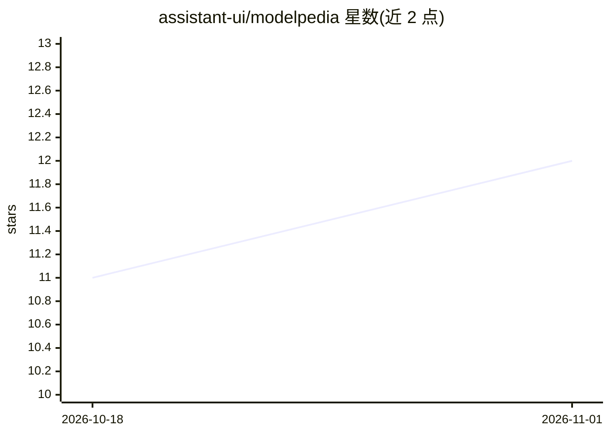

# assistant-ui/modelpedia

⭐ 12 · TypeScript · MIT · 推送 2026-10-31 · [GitHub](https://github.com/assistant-ui/modelpedia) · [官网](https://modelpedia.dev) · 组织维护

**跨厂商 AI 模型开放目录：规格、价格、能力查询**

聚合 30+ 提供商共 4000+ 个 AI 模型的开放目录，收录规格、定价、能力与模态信息，每日从官方 provider API 自动更新。提供 modelpedia.dev 网站、免费 REST API（api.modelpedia.dev）以及 npm 包供程序化访问（getModel/getProvider 等）。数据以 JSON 文件存于仓库，可用 pnpm 脚本拉取、生成与校验，采用 MIT 许可。

## 筛选速览

| 维度 | 判定 | 备注 |
|---|---|---|
| AI 角色 | `ai-knowledge` | 知识聚合/清单类 |
| 许可风险 | `permissive` | MIT |
| 部署形态 | `library` | 以包/库形式分发 |
| 模型依赖 | — | README 未给出锁定关系 |
| 硬件要求 | — | 无带数字的原话,不猜 |
| 安装摩擦 | `low` | 无编译、无系统依赖或容器化 |
| 成熟度 | — | 结构信号不足 |

## 能力要点

- 4000+ 模型、30+ 提供商的规格/定价/能力目录
- 每日从官方 provider API 自动更新
- 免费 REST API 与 npm 包程序化访问
- 模型规格并排对比

## 适用场景

- 选型时并排对比多个模型的定价与能力
- 在应用中通过 npm 包或 API 查询模型元数据
- 跟踪各厂商模型目录的最新变化

## 场景标签

`精选清单` · 领域:学习与行业

## 证据(README 行号)

> L3: Open catalog of AI models across providers. Compare specs, pricing, and capabilities.
> L13: - 4000+ models across 30+ providers

## 星数曲线

2026-10-18 11 → 2026-11-01 12（+1）

---
*卡片 v1 · prompt 1.4 · 生成 2026-11-01 · 置信度 high · 依据 README sha `ea55e0a0358d` · [字段定义](../../DATASET.md)*
