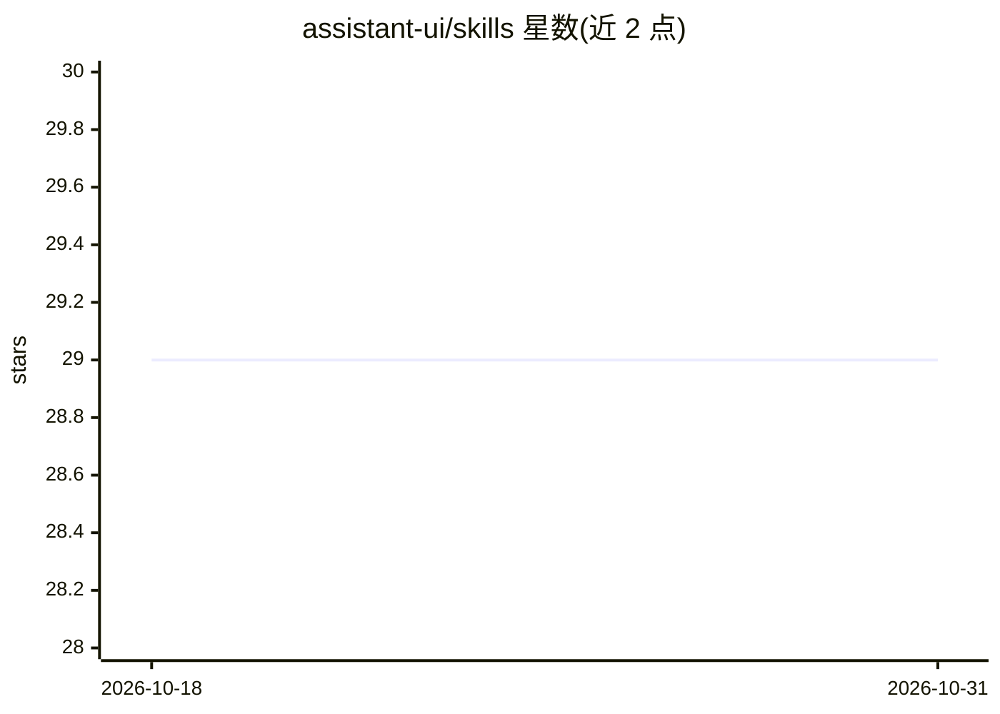

# assistant-ui/skills

⭐ 29 · JavaScript · 推送 2026-10-27 · [GitHub](https://github.com/assistant-ui/skills) · [官网](https://assistant-ui.com) · 组织维护

**assistant-ui 框架的 Agent 技能包：指导构建 AI 聊天界面**

面向使用 assistant-ui 框架开发者的 agent 技能集合：通过 npx skills add 安装后，在 Claude Code 中以 / 前缀调用 17 个技能（如 /setup 脚手架、/elements 组件目录、/runtime 运行时适配、/tools 工具与 MCP、/observability 后端追踪等），覆盖从项目搭建到迁移升级的开发环节。维护侧提供校验脚本，检查代码块中的 import 是否为真实导出、相对链接是否可解析，并拒绝已废弃写法。MIT 许可。

## 筛选速览

| 维度 | 判定 | 备注 |
|---|---|---|
| AI 角色 | `ai-knowledge` | 知识聚合/清单类 |
| 许可风险 | `none` | — |
| 部署形态 | `library` | 以包/库形式分发 |
| 模型依赖 | — | README 未给出锁定关系 |
| 硬件要求 | — | 无带数字的原话,不猜 |
| 安装摩擦 | `low` | 无编译、无系统依赖或容器化 |
| 成熟度 | — | 结构信号不足 |

## 能力要点

- 17 个技能覆盖架构、脚手架、组件、运行时、MCP、可观测性等主题
- npx 一条命令安装，Claude Code 中以 / 技能名调用
- 维护脚本校验代码块 import 与链接、拒绝废弃约定

## 适用场景

- 在 Claude Code 里快速生成 assistant-ui 项目脚手架与组件
- 开发聊天界面时查询运行时适配器、工具 UI 与 MCP 用法
- 升级 assistant-ui 与 AI SDK 版本、运行 codemods 迁移

## 场景标签

`代码生成` · 领域:编码与开发

## 证据(README 行号)

> L3: Agent skills for building AI chat interfaces with assistant-ui.
> L35: After installation, type `/` followed by the skill name in Claude Code, for example `/setup` to scaffold a project 

## 星数曲线

2026-10-18 29 → 2026-10-31 29（+0）

---
*卡片 v1 · prompt 1.4 · 生成 2026-10-26 · 置信度 high · 依据 README sha `eb9a8ab29b34` · [字段定义](../../DATASET.md)*
