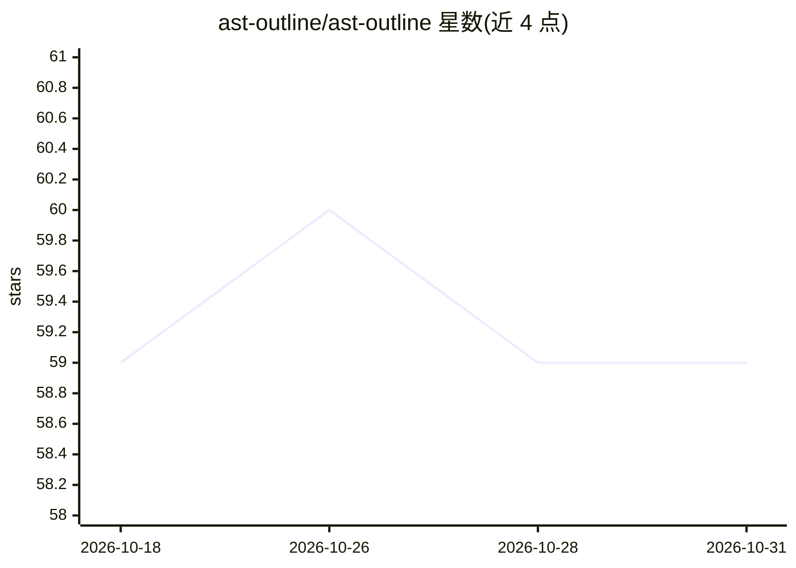

# ast-outline/ast-outline

⭐ 59 · Python · Apache-2.0 · 推送 2026-07-28 · [GitHub](https://github.com/ast-outline/ast-outline) · [官网](https://ast-outline.github.io/) · 个人维护 · 中文 README

**给 AI 编程代理按需提取代码上下文的 tree-sitter CLI**

基于 tree-sitter 的无状态命令行工具，让 LLM 编程代理以仓库骨架、文件大纲、单个符号体的方式按需读取代码，而非整文件读入。提供 outline/digest/show/grep 四个结构化命令及 AST 感知的用法检索，支持 20 余种语言（C#/C++/Python/TS/Go/Rust 等）；grep 默认过滤注释与字符串，JSON 输出供程序化消费。通过 setup-prompt 把用法片段写入 AGENTS.md/CLAUDE.md 等代理上下文文件，接入 Claude Code、Codex CLI、Cursor 等工具。无索引、无缓存、无网络调用。

## 筛选速览

| 维度 | 判定 | 备注 |
|---|---|---|
| AI 角色 | `ai-ecosystem` | LLM/agent 周边工具 |
| 许可风险 | `permissive` | Apache-2.0 |
| 部署形态 | `library` | 以包/库形式分发 |
| 模型依赖 | — | README 未给出锁定关系 |
| 硬件要求 | — | 无带数字的原话,不猜 |
| 安装摩擦 | `low` | 无编译、无系统依赖或容器化 |
| 成熟度 | — | 结构信号不足 |

## 能力要点

- outline/digest/show/grep 四命令输出仓库地图、文件大纲与符号体
- 基于 tree-sitter 的 AST 结构化检索，默认过滤注释与字符串噪声
- setup-prompt 自动把用法片段写入 AGENTS.md/CLAUDE.md 并可覆盖探索子代理
- 支持 C#、C++、Python、TypeScript、Go、Rust、Java 等 20 余种语言

## 适用场景

- LLM 编程代理探索大代码库时减少 token 消耗
- 让代理只读取所需符号体而非整文件
- 结构化检索符号用法并按所属类/函数分组

## 场景标签

 · 领域:开发者工具/代码分析

## 证据(README 行号)

> L22: LLM coding agents (Claude Code, Cursor agent mode, Aider, Codex CLI, Gemini CLI,
> L29: `ast-outline` is a pre-reading layer. The agent calls it first, gets the file's
> L234: - **No MCP server.** For a stateless CLI an agent gets more leverage piping

## 星数曲线

2026-10-18 59 → 2026-10-31 59（+0）

---
*卡片 v1 · prompt 1.4 · 生成 2026-10-24 · 置信度 high · 依据 README sha `7fdf389d28a5` · [字段定义](../../DATASET.md)*
