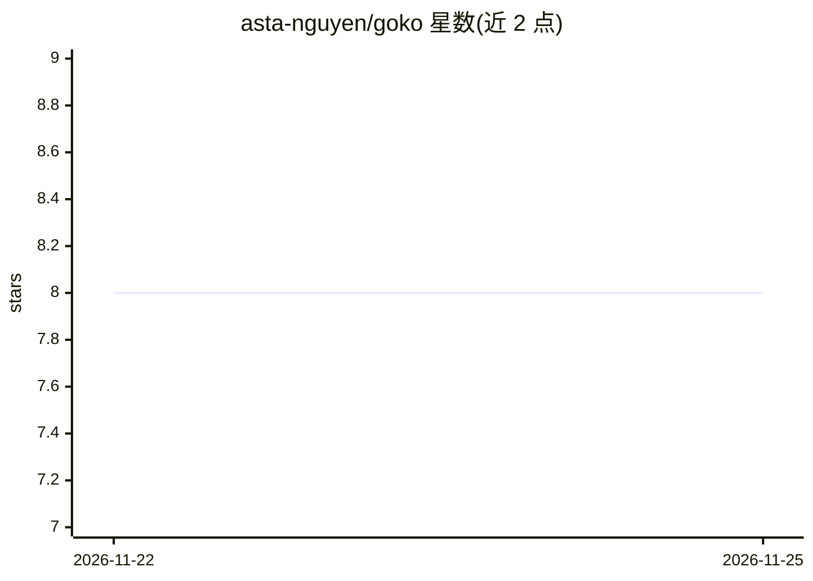

# asta-nguyen/goko

⭐ 8 · Rust · Apache-2.0 · 推送 2026-11-23 · [GitHub](https://github.com/asta-nguyen/goko) · [官网](https://goko.astalife.co) · 个人维护

**按项目管理交互式命令行 AI Agent 的跨平台桌面应用**

Goko 是一个运行于 macOS、Linux 和 Windows 的桌面应用，用于按项目运行交互式命令行 agent。原生 Rune 应用通过 Unix socket（Windows 为命名管道）与 Rust 编写的 gokod 守护进程通信，由守护进程持有终端 PTY 与子进程；项目与会话元数据存储在 SQLite 中。应用包含 UI、终端与编辑器组件，支持 ACP 与语言服务器。安装脚本可自动下载并校验 release，Intel Mac 与其他场景可从源码构建。

## 筛选速览

| 维度 | 判定 | 备注 |
|---|---|---|
| AI 角色 | `ai-ecosystem` | LLM/agent 周边工具 |
| 许可风险 | `permissive` | Apache-2.0 |
| 部署形态 | `desktop` | 安装包/桌面程序 |
| 模型依赖 | — | README 未给出锁定关系 |
| 硬件要求 | — | 无带数字的原话,不猜 |
| 安装摩擦 | `medium` | 含编译或系统依赖之一 |
| 成熟度 | `idea` | |

## 能力要点

- 桌面应用按项目运行命令行 agent，守护进程持有 PTY 与子进程
- 安装脚本下载 release 并校验 sha256（macOS 另验签名）
- 应用内更新检查与就地更新（可用环境变量关闭）
- 支持 ACP、语言服务器与 Git worktree 管理

## 适用场景

- 在同一台机器上按项目分隔运行多个命令行 agent 会话
- 通过图形界面管理 agent 的终端进程与会话元数据
- 为 Claude Code、Codex、Devin 等 CLI agent 提供统一运行环境

## 场景标签

`编码 Agent` · 领域:编码与开发

## 证据(README 行号)

> L5: Goko is a desktop app for macOS, Linux and Windows for running interactive
> L6: command-line agents by project. The native Rune app (`apps/rune`) talks to the
> L20: |`crates/app-core`|`goko.db` store, Git/worktrees, agents, ACP, language servers|

## 星数曲线

2026-11-22 8 → 2026-11-25 8（+0）

---
*卡片 v1 · prompt 1.4 · 生成 2026-11-22 · 置信度 mid · 依据 README sha `d9571e1ebe5a` · [字段定义](../../DATASET.md)*
