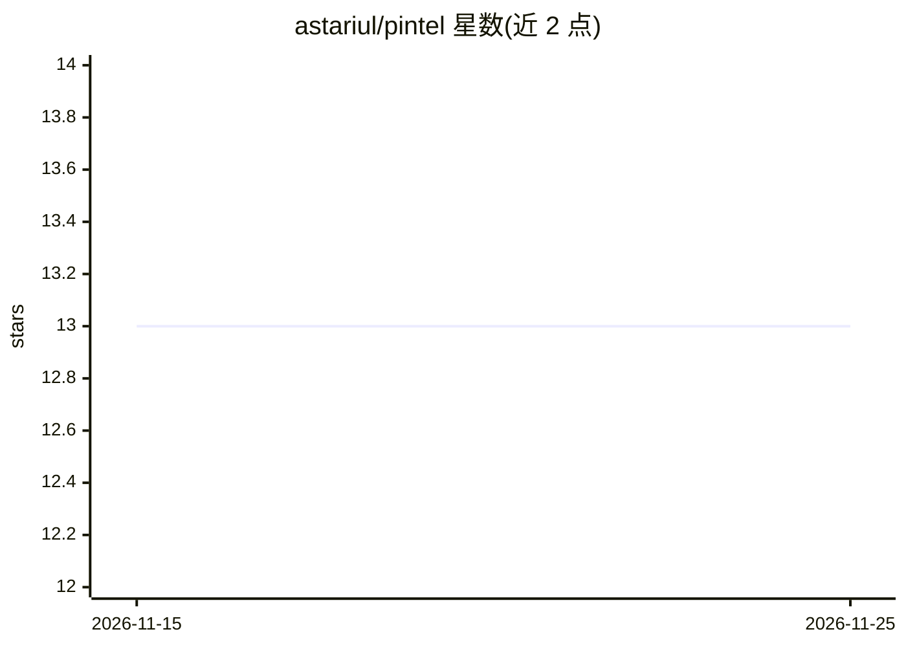

# astariul/pintel

⭐ 13 · Python · MIT · 推送 2026-11-14 · [GitHub](https://github.com/astariul/pintel) · [官网](https://astariul.github.io/pintel/) · 个人维护

**跨进程与机器异步扩展 ML worker 的 Python 库**

pintel 是一个 Python 包，用于将 ML 模型推理（或任意 Python 代码）异步扩展到多个进程和多台机器。用法为定义模型后启动若干 Worker 进程提供并行服务，通过 Hub 以 async/await 方式发送请求；底层基于 ZeroMQ 的 Paranoid Pirate 模式的修改实现，将模型代码运行在独立进程中并分发请求。以 pip 包发布，附 examples 目录与 mkdocs 文档。

## 筛选速览

| 维度 | 判定 | 备注 |
|---|---|---|
| AI 角色 | `ai-ecosystem` | LLM/agent 周边工具 |
| 许可风险 | `permissive` | MIT |
| 部署形态 | `library` | 以包/库形式分发 |
| 模型依赖 | — | README 未给出锁定关系 |
| 硬件要求 | — | 无带数字的原话,不猜 |
| 安装摩擦 | `low` | 无编译、无系统依赖或容器化 |
| 成熟度 | — | 结构信号不足 |

## 能力要点

- Worker/Hub 架构：多进程运行模型、异步发送请求
- 基于 zmq Paranoid Pirate 模式的修改实现
- 支持跨进程与跨机器扩展任意 Python 代码
- 提供 examples 示例与 mkdocs 本地文档

## 适用场景

- 为 ML 模型推理启动多个并行 worker
- 异步客户端向模型服务发送请求
- 将 Python 计算任务分布到多台机器

## 场景标签

`推理引擎` · 领域:训练与推理

## 证据(README 行号)

> L22: **`pintel`** is a python package that helps you scale your ML workers (or any python code) across processes and mac
> L79: `pintel` simply run your model code in separate processes, and send requests to the right process to ensure request

## 星数曲线

2026-11-15 13 → 2026-11-25 13（+0）

---
*卡片 v1 · prompt 1.4 · 生成 2026-11-18 · 置信度 high · 依据 README sha `8820c7b9decf` · [字段定义](../../DATASET.md)*
