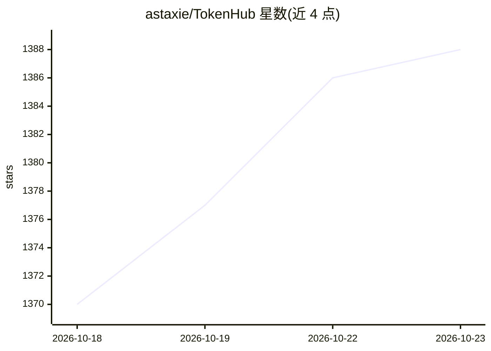

# astaxie/TokenHub

⭐ 1,388 · Go · Apache-2.0 · 推送 2026-10-20 · [GitHub](https://github.com/astaxie/TokenHub) · [官网](https://thinkinai-labs.github.io/tokenhome/) · 个人维护 · 中文 README

**企业级 AI 模型访问治理网关：统一路由、权限与成本核算**

面向企业的 Token 治理基础设施：以网关形式统一接入 OpenAI、Azure OpenAI、Anthropic、Gemini、DeepSeek、Qwen、Codex 订阅及本地模型等上游，提供模型路由（优先级/权重/故障转移）、按项目与团队的 API key 权限管理、配额与并发控制、用量归因与账单对账、预算控制，以及 OAuth/OIDC 身份源、RBAC 和审计。对外暴露 OpenAI 兼容 API（chat/completions、embeddings、images）与 Anthropic Messages API。SQLite 单机或 PostgreSQL 多实例部署，支持原生 systemd 安装脚本与 Docker Compose。

## 筛选速览

| 维度 | 判定 | 备注 |
|---|---|---|
| AI 角色 | `ai-ecosystem` | LLM/agent 周边工具 |
| 许可风险 | `permissive` | Apache-2.0 |
| 部署形态 | `self-host` | docker 或自建部署 |
| 模型依赖 | locked-api |  |
| 硬件要求 | — | 无带数字的原话,不猜 |
| 安装摩擦 | `low` | 无编译、无系统依赖或容器化 |
| 成熟度 | — | 结构信号不足 |

## 能力要点

- 原生 Provider 适配器覆盖 OpenAI/Azure/Anthropic/Gemini/DeepSeek/Qwen 等，另有 150+ 供应商模板
- 项目级 key 管理：成员权限、配额、并发控制
- 模型路由策略：优先级、权重、failover、路由健康诊断
- 用量按用户/项目/团队/模型归因，支持供应商账单对账

## 适用场景

- 企业统一管控各团队的 AI 模型调用与费用
- 为应用发放项目级 API key 而非直接分发供应商原始密钥
- 财务与平台团队核对内部用量与供应商账单

## 场景标签

`模型网关` · 领域:Agent 开发

## 证据(README 行号)

> L5:  TokenHub is enterprise Token Governance infrastructure for AI: model routing, access control, token cost optimizati
> L75: Provider support is TokenHub's integration boundary. Hosted APIs, subscription channels, local models, and custom u

## 星数曲线

2026-10-18 1,370 → 2026-10-23 1,388（+18）

---
*卡片 v1 · prompt 1.4 · 生成 2026-10-21 · 置信度 high · 依据 README sha `5b45f8323965` · [字段定义](../../DATASET.md)*
