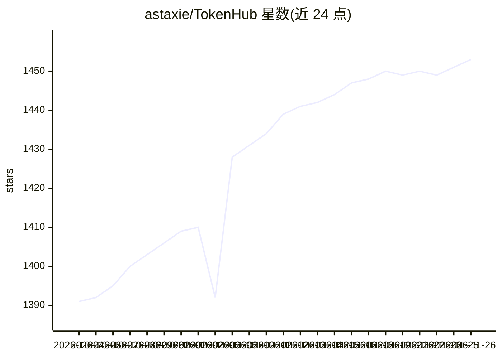

# astaxie/TokenHub

⭐ 1,453 · Go · Apache-2.0 · 推送 2026-11-20 · [GitHub](https://github.com/astaxie/TokenHub) · [官网](https://thinkinai-labs.github.io/tokenhome/) · 个人维护 · 中文 README

**企业级 AI 模型访问治理网关：路由、权限与成本归因**

面向企业的 Token 治理基础设施，在模型调用之前设置治理层：模型路由、按人/团队/项目的密钥与权限分配、缓存与配额降本、用量归因及与上游账单的对账。平台区分用户、团队负责人、管理员三种角色工作区，提供 OpenAI 兼容及 Anthropic Messages 格式 API，支持 SQLite 单机与 PostgreSQL 多实例部署，提供 systemd 与 Docker Compose 两种安装方式。基于 Go 1.26 构建。

## 筛选速览

| 维度 | 判定 | 备注 |
|---|---|---|
| AI 角色 | `ai-ecosystem` | LLM/agent 周边工具 |
| 许可风险 | `permissive` | Apache-2.0 |
| 部署形态 | `self-host` | docker 或自建部署 |
| 模型依赖 | locked-api |  |
| 硬件要求 | — | 无带数字的原话,不猜 |
| 安装摩擦 | `low` | 无编译、无系统依赖或容器化 |
| 成熟度 | — | 结构信号不足 |

## 能力要点

- 项目级密钥管理：成员权限、配额与并发控制
- 路由策略支持优先级、权重、故障转移与健康诊断
- 用量按用户/项目/团队/模型/成本中心归因并可对账
- OAuth/OIDC 企业登录、RBAC 与审计日志

## 适用场景

- 企业内统一管理多团队的模型密钥与访问权限
- 按场景、成本与健康状况路由模型调用
- 将内部用量与上游账单对账以核算 AI 成本
- 私有化部署一套模型接入治理平台

## 场景标签

`模型网关` · 领域:Agent 开发

## 证据(README 行号)

> L5:  TokenHub is enterprise Token Governance infrastructure for AI: model routing, access control, token cost optimizati
> L65: - OpenAI-compatible model APIs: `/v1/chat/completions`, `/v1/responses`, `/v1/embeddings`; Anthropic Messages APIs:

## 星数曲线

2026-10-24 1,391 → 2026-11-26 1,453（+62）

---
*卡片 v1 · prompt 1.4 · 生成 2026-11-23 · 置信度 high · 依据 README sha `99976cd5ebba` · [字段定义](../../DATASET.md)*
