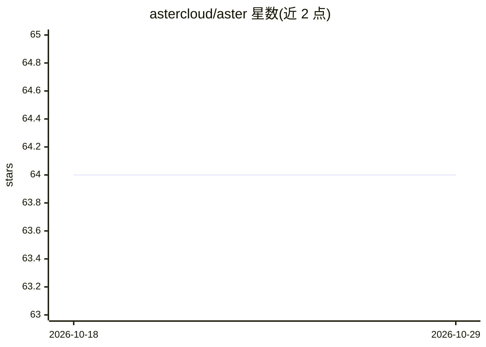

# astercloud/aster

⭐ 64 · Go · MIT · 推送 2025-12-29 · [GitHub](https://github.com/astercloud/aster) · [官网](https://astercloud.github.io/aster/) · 组织维护 · 中文 README

**Go 构建的生产级 AI Agent 框架，面向企业级应用**

Aster（星尘云枢）是用 Go 语言构建的 AI Agent 框架，面向生产环境与企业级应用。实现 Google Context Engineering 白皮书的核心特性，包括事件驱动架构（Progress/Control/Monitor 三通道）、三层记忆系统（Text/Working/Semantic Memory，含溯源与合并）、8 种步骤类型的 Workflow 编排、PII 检测与提示注入防护等安全护栏、OpenTelemetry 可观测性、PostgreSQL/MySQL 持久化与 MCP 协议工具扩展；云沙箱集成阿里云 AgentBay 与火山引擎。通过 go get 安装，提供最小示例与完整文档。版本 v0.17.0，MIT 许可。

## 筛选速览

| 维度 | 判定 | 备注 |
|---|---|---|
| AI 角色 | `ai-ecosystem` | LLM/agent 周边工具 |
| 许可风险 | `permissive` | MIT |
| 部署形态 | `None` |  |
| 模型依赖 | — | README 未给出锁定关系 |
| 硬件要求 | — | 无带数字的原话,不猜 |
| 安装摩擦 | `low` | 无编译、无系统依赖或容器化 |
| 成熟度 | — | 结构信号不足 |

## 能力要点

- 事件驱动架构：Progress/Control/Monitor 三通道设计
- 三层记忆系统（Text/Working/Semantic Memory）含溯源与合并
- Workflow 编排：8 种步骤类型 + 动态路由 + 并行/顺序/循环
- 安全防护栏：PII 检测、提示注入防护、内容审核

## 适用场景

- 用 Go 构建生产环境的 AI Agent 应用
- 编排带记忆与多 Agent 协作的工作流
- 企业场景中对 Agent 做 PII 防护与可观测性接入

## 场景标签

`Agent 框架` `多智能体` · 领域:Agent 开发

## 证据(README 行号)

> L19: Aster 是一个**生产级 AI Agent 框架**，用 Go 语言构建，专为企业级应用设计。它完整实现了 Google Context Engineering 白皮书的所有核心特性。
> L27: |🔀 **Workflow 编排**|8 种步骤类型 + 动态路由 + 并行/顺序/循环|

## 星数曲线

2026-10-18 64 → 2026-10-29 64（+0）

---
*卡片 v1 · prompt 1.4 · 生成 2026-10-24 · 置信度 high · 依据 README sha `b9a0ec3ca7ae` · [字段定义](../../DATASET.md)*
