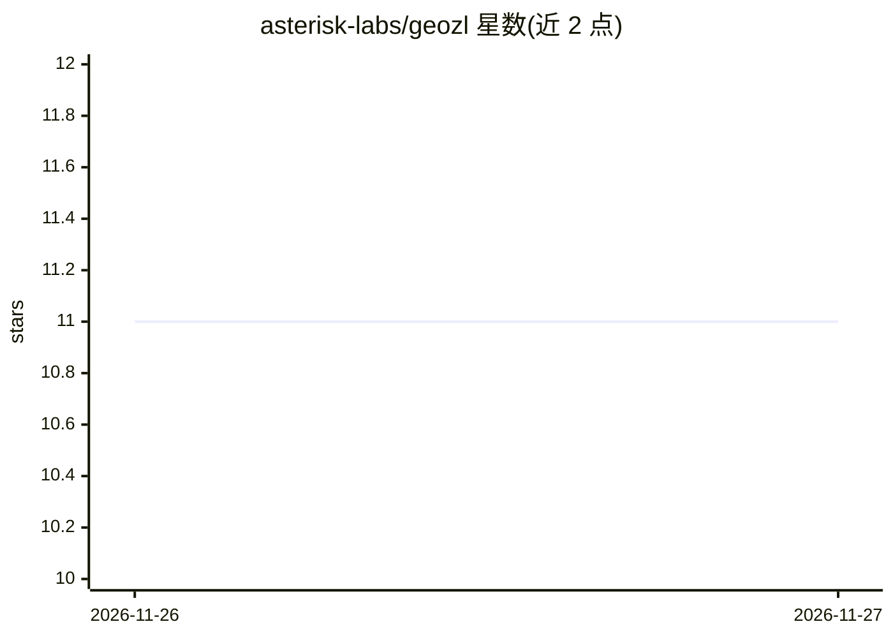

# asterisk-labs/geozl

⭐ 11 · C · NOASSERTION · 推送 2026-11-23 · [GitHub](https://github.com/asterisk-labs/geozl) · [官网](http://asterisk.coop/geozl/) · 组织维护

**面向地球观测数据的 OpenZL 地理空间编解码扩展**

GeoZL 在 OpenZL 基础上为地球观测数据添加空间预测、NoData 处理、整数打包与有界误差量化等编解码器，处理多维数值数组。同一核心提供 C、Python、R、Julia、JavaScript 绑定，并支持在 NVIDIA GPU（CUDA/PTX）与 Apple silicon（Metal）上解码，内核内嵌于库中无需 CUDA toolkit。由 Asterisk Labs 在 Earth Compress 项目下开发，获 ARIA 资助，采用 BSD-3-Clause 许可。

## 筛选速览

| 维度 | 判定 | 备注 |
|---|---|---|
| AI 角色 | `ai-enhanced` | 去掉 AI 部分产品仍成立 |
| 许可风险 | `permissive` | NOASSERTION |
| 部署形态 | `library` | 以包/库形式分发 |
| 模型依赖 | — | README 未给出锁定关系 |
| 硬件要求 | — | 无带数字的原话,不猜 |
| 安装摩擦 | `medium` | 含编译或系统依赖之一 |
| 成熟度 | — | 结构信号不足 |

## 能力要点

- 为多维数值数组提供空间预测、NoData 处理、整数打包与有界误差量化编解码
- C/Python/R/Julia/JavaScript 五语言绑定同一核心
- 支持 NVIDIA CUDA 与 Apple Metal GPU 解码，内核内嵌免 CUDA toolkit
- 提供 coding agent 技能安装（npx skills add）

## 适用场景

- 压缩卫星与对地观测的多维数值数据
- 在 GPU 上解码压缩的地球观测数据
- 从 Python/R/Julia/JS 调用同一压缩核心

## 场景标签

 · 领域:地球观测/数据压缩

## 证据(README 行号)

> L13: GeoZL extends OpenZL with codecs designed
> L57: Install the GeoZL skill so coding agents know its graph recipes, bounded-error rules and codec internals.

## 星数曲线

2026-11-26 11 → 2026-11-27 11（+0）

---
*卡片 v1 · prompt 1.4 · 生成 2026-11-26 · 置信度 high · 依据 README sha `d11cb059c60d` · [字段定义](../../DATASET.md)*
