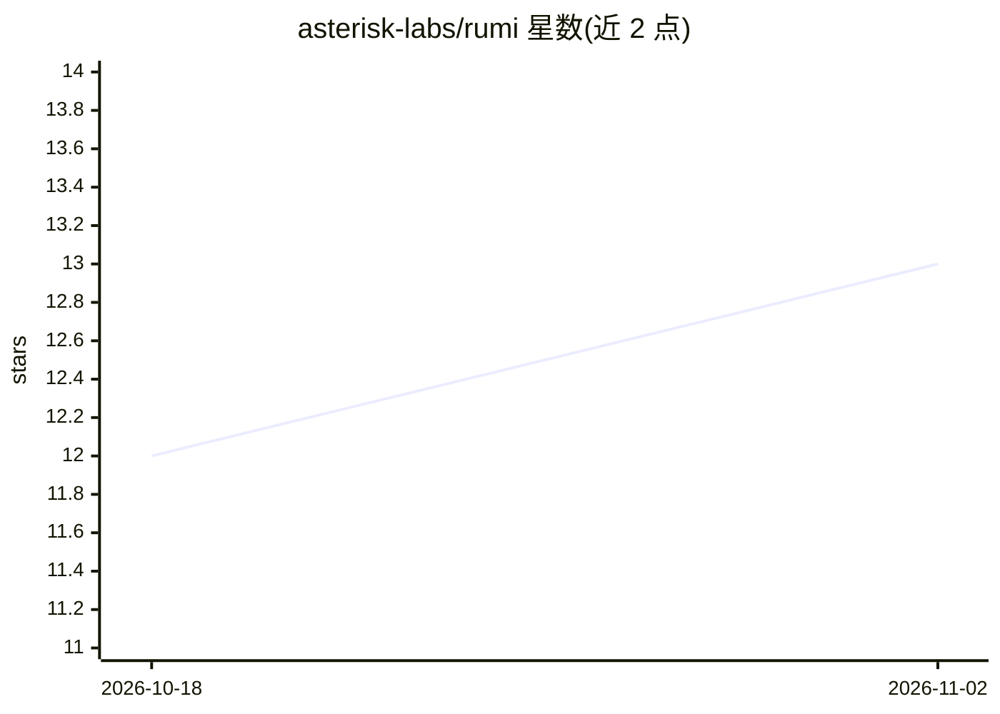

# asterisk-labs/rumi

⭐ 13 · C · GPL-3.0 · 推送 2026-11-01 · [GitHub](https://github.com/asterisk-labs/rumi) · [官网](http://asterisk.coop/rumi/) · 组织维护

**面向 AI4EO 的无状态栅格存储格式，按帧切分影像与数据立方**

面向 AI 遥感（AI4EO）的栅格存储库：把影像 (B, Y, X) 或带时间的立方 (T, B, Y, X) 切成独立压缩的帧，索引保存在小型外置头文件中，读取时只取所需帧。支持 einops 记法的存储布局、GeoZL 编码（唯一支持编解码器，帧级可变压缩图）、read_many 并发读取多文件窗口、多线程解码与零拷贝数组（NumPy/PyTorch/JAX/TensorFlow，DLPack）。通过 Karu 可从本地、HTTP、S3、GCS、Azure、Hugging Face 等位置读取，并提供 C API。README 声明 1.0 前格式可能变化。

## 筛选速览

| 维度 | 判定 | 备注 |
|---|---|---|
| AI 角色 | `ai-ecosystem` | LLM/agent 周边工具 |
| 许可风险 | `viral` | GPL-3.0 |
| 部署形态 | `library` | 以包/库形式分发 |
| 模型依赖 | — | README 未给出锁定关系 |
| 硬件要求 | — | 无带数字的原话,不猜 |
| 安装摩擦 | `medium` | 含编译或系统依赖之一 |
| 成熟度 | `idea` | |

## 能力要点

- 按帧独立压缩 + 外置头索引，读取仅取所需帧
- einops 记法定义瓦片存储布局
- read_many 并发读取多文件窗口，适配训练数据加载
- DLPack 零拷贝支持 NumPy/PyTorch/JAX/TensorFlow，21 种 dtype

## 适用场景

- 为深度学习训练提供高效读取的遥感影像存储
- 管理带时间维度的影像立方数据
- 从 S3/GCS/Azure/Hugging Face 等远程位置直接读取栅格

## 场景标签

`MLOps` · 领域:训练与推理

## 证据(README 行号)

> L10: Rumi is stateless raster storage for AI4EO. It cuts an Image or a Cube into independently
> L25: - **Minibatches in one call**, with `read_many` fetching windows from many files
> L26:  concurrently, ideal for training data loaders.

## 星数曲线

2026-10-18 12 → 2026-11-02 13（+1）

---
*卡片 v1 · prompt 1.4 · 生成 2026-11-01 · 置信度 mid · 依据 README sha `1ce43d2f326e` · [字段定义](../../DATASET.md)*
