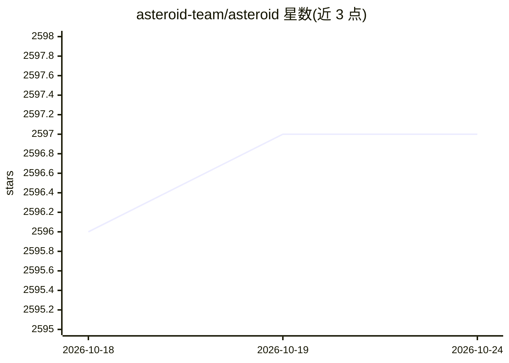

# asteroid-team/asteroid

⭐ 2,597 · Python · MIT · 推送 2026-09-29 · [GitHub](https://github.com/asteroid-team/asteroid) · [官网](https://asteroid-team.github.io/) · 组织维护

**面向研究者的 PyTorch 音频源分离工具包**

基于 PyTorch 的音频源分离工具包，面向研究者，支持快速实验。提供可组合的模块化组件（filterbank、编码器、掩码器、解码器、损失函数），内置 ConvTasNet、DPRNN、DCCRN 等多种分离架构的复现配方，支持 WSJ0-2mix、WHAM、LibriMix、MUSDB18 等常见数据集，配套 TensorBoard 日志与预训练模型入口。通过 pip/conda 或源码安装，运行配方需额外安装 requirements.txt 中的依赖。

## 筛选速览

| 维度 | 判定 | 备注 |
|---|---|---|
| AI 角色 | `ai-native` | 本体是模型或模型工具 |
| 许可风险 | `permissive` | MIT |
| 部署形态 | `library` | 以包/库形式分发 |
| 模型依赖 | — | README 未给出锁定关系 |
| 硬件要求 | — | 无带数字的原话,不猜 |
| 安装摩擦 | `low` | 无编译、无系统依赖或容器化 |
| 成熟度 | — | 结构信号不足 |

## 能力要点

- 模块化组件：filterbank/编码器/掩码器/解码器/损失可自由组合
- 复现多篇论文的配方（ConvTasNet、DPRNN、SudoRMRFNet、DPTNet 等）
- 支持 WSJ0-2mix、WHAM、LibriMix、MUSDB18 等 10 类数据集
- 配方默认集成 TensorBoard 训练日志

## 适用场景

- 复现或对比音频源分离论文方法
- 用模块化组件搭建自定义分离网络
- 在标准数据集上训练语音增强/分离系统

## 场景标签

`模型训练` · 领域:训练与推理

## 证据(README 行号)

> L15: Asteroid is a Pytorch-based audio source separation toolkit
> L18: of datasets and architectures, and a set of

## 星数曲线

2026-10-18 2,596 → 2026-10-24 2,597（+1）

---
*卡片 v1 · prompt 1.4 · 生成 2026-10-21 · 置信度 high · 依据 README sha `57c25054cf16` · [字段定义](../../DATASET.md)*
