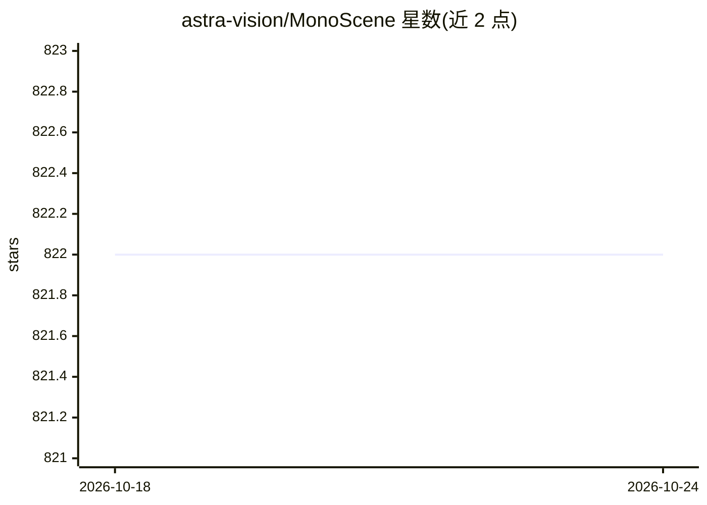

# astra-vision/MonoScene

⭐ 822 · Python · Apache-2.0 · 推送 2026-03-25 · [GitHub](https://github.com/astra-vision/MonoScene) · [官网](https://astra-vision.github.io/MonoScene/) · 组织维护

**CVPR 2022 单目图像 3D 语义占据预测研究代码**

MonoScene 是 CVPR 2022 论文的官方 PyTorch 实现，从单张 RGB 图像预测 3D 语义场景补全（体素级语义占据）。面向计算机视觉研究者，提供在 SemanticKITTI 与 NYUv2 上训练、评估、推理与可视化的完整脚本，支持 KITTI-360 推理，并提供预训练模型与 Hugging Face 演示。实现基于 Python 3.7 / PyTorch 1.7.1 / CUDA 10.2，安装需多步 conda/pip 环境配置与数据集预处理；可视化依赖 mayavi（可用 Open3D 替代）。Apache 2.0 许可。

## 筛选速览

| 维度 | 判定 | 备注 |
|---|---|---|
| AI 角色 | `ai-native` | 本体是模型或模型工具 |
| 许可风险 | `permissive` | Apache-2.0 |
| 部署形态 | `library` | 以包/库形式分发 |
| 模型依赖 | — | README 未给出锁定关系 |
| 硬件要求 | — | 无带数字的原话,不猜 |
| 安装摩擦 | `medium` | 含编译或系统依赖之一 |
| 成熟度 | — | 结构信号不足 |

## 能力要点

- 单张 RGB 图像预测体素级 3D 语义占据
- 提供 SemanticKITTI / NYUv2 训练、评估与推理脚本
- 提供预训练模型与 Hugging Face 在线演示
- 支持 mayavi / Open3D 可视化输出

## 适用场景

- 复现论文在 SemanticKITTI/NYUv2 上的结果
- 在 KITTI-360 序列上做单目场景补全推理
- 作为 3D 占据预测研究的相关工作参考与基线

## 场景标签

 · 领域:计算机视觉/3D 感知

## 证据(README 行号)

> L1: # MonoScene: Monocular 3D Semantic Scene Completion
> L3: **MonoScene: Monocular 3D Semantic Scene Completion**\

## 星数曲线

2026-10-18 822 → 2026-10-24 822（+0）

---
*卡片 v1 · prompt 1.4 · 生成 2026-10-21 · 置信度 high · 依据 README sha `4334c6f7b90f` · [字段定义](../../DATASET.md)*
