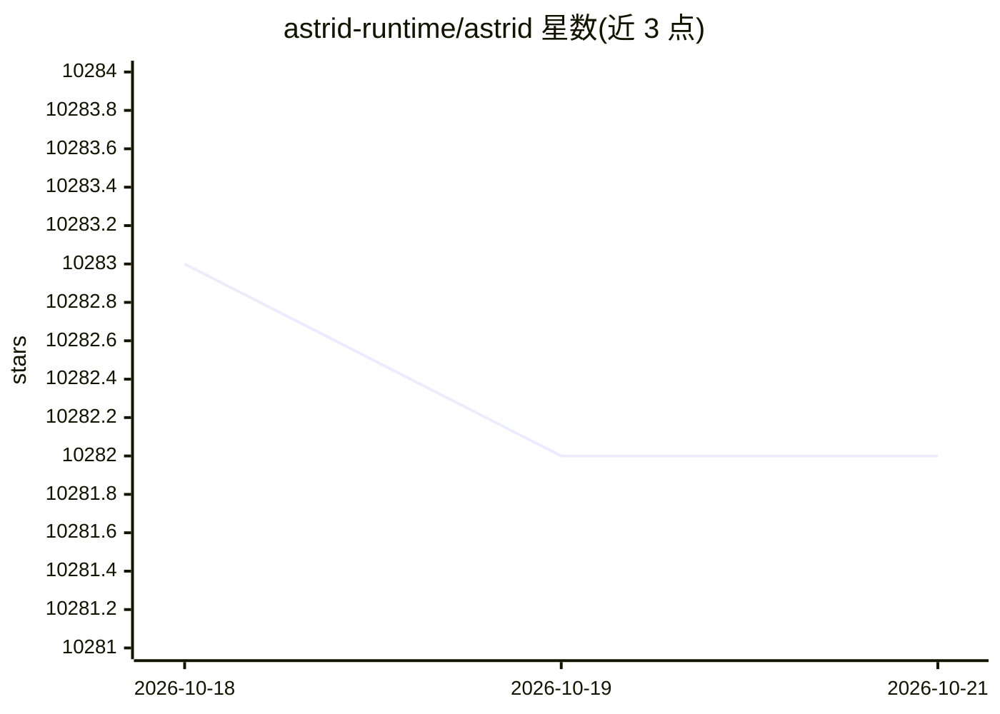

# astrid-runtime/astrid

⭐ 10,282 · Rust · Apache-2.0 · 推送 2026-10-15 · [GitHub](https://github.com/astrid-runtime/astrid) · 组织维护

**面向 agent 的能力安全 WASM 运行时：沙箱化组合并隔离各组件权限**

Astrid 是以 WebAssembly capsule 为组合单元的用户空间运行时（macOS/Linux），方向是独立操作系统。capsule 在 Wasmtime 沙箱中运行、无环境权限，文件/网络/进程等访问经 ed25519 签名的能力授权在运行时边界检查；内核只做事件总线与 IPC 路由，不含 LLM 句柄。支持 per-principal 隔离（KV、密钥、配额、审计链）、运行中热装载 capsule、内容寻址存储与 macOS FSKit / Linux FUSE 挂载。供构建 agent 系统、工具与自有发行版的开发者使用；不选择模型提供商或 agent 循环，LLM 能力由 distro 中的 capsule 提供。

## 筛选速览

| 维度 | 判定 | 备注 |
|---|---|---|
| AI 角色 | `ai-ecosystem` | LLM/agent 周边工具 |
| 许可风险 | `permissive` | Apache-2.0 |
| 部署形态 | `library` | 以包/库形式分发 |
| 模型依赖 | — | README 未给出锁定关系 |
| 硬件要求 | — | 无带数字的原话,不猜 |
| 安装摩擦 | `medium` | 含编译或系统依赖之一 |
| 成熟度 | — | 结构信号不足 |

## 能力要点

- capsule 运行于 Wasmtime 沙箱，无 syscall/文件描述符/宿主内存，外部效果均经能力检查
- ed25519 签名能力授权：资源模式限定、绑定 principal、可过期、可全局吊销
- per-principal 隔离的 KV、密钥、home 目录、配额与哈希链接的签名审计链
- 运行中的 daemon 上安装/升级/移除 capsule，无需重启

## 适用场景

- 把不受信任的 agent 代码放进沙箱运行并精确授权其文件与网络访问
- 构建由可组合 capsule 构成的 agent 系统或自有发行版
- 为不同 agent 身份提供互相隔离的状态与凭据环境

## 场景标签

`Agent 框架` · 领域:Agent 开发

## 证据(README 行号)

> L21: Use it to build agent systems, tools, services, or your own distribution. Astrid
> L69: Agent frameworks put trust in the prompt. Astrid puts it in the runtime. An agent is untrusted code
> L80:  capability ACL. It has no LLM handles, no conversation state, and no tool registry. All

## 星数曲线

2026-10-18 10,283 → 2026-10-21 10,282（-1）

---
*卡片 v1 · prompt 1.4 · 生成 2026-10-20 · 置信度 high · 依据 README sha `26d248e3a4d2` · [字段定义](../../DATASET.md)*
