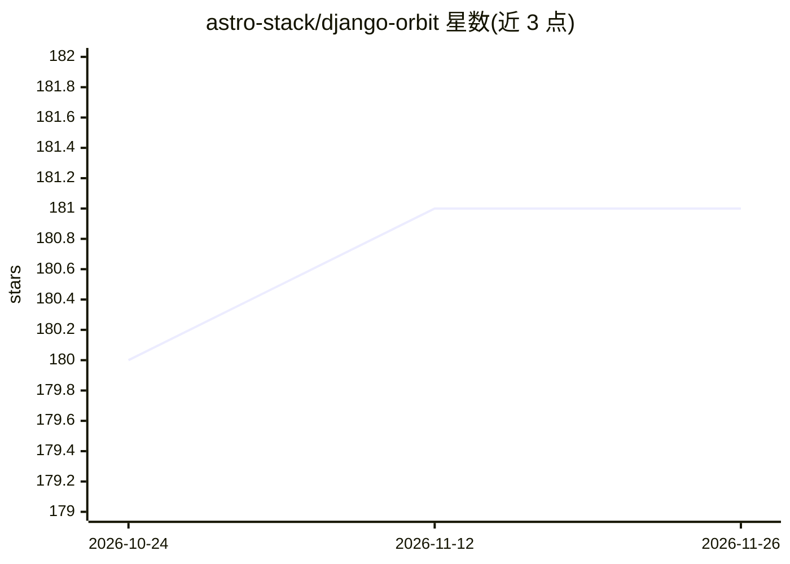

# astro-stack/django-orbit

⭐ 181 · Python · MIT · 推送 2026-11-18 · [GitHub](https://github.com/astro-stack/django-orbit) · [官网](https://labs.wearehik.com/django-orbit) · 组织维护

**给 Django 开发者与编码 agent 提供运行时取证与调试**

嵌入 Django 请求生命周期的观测组件：通过 watcher 捕获 HTTP 请求、SQL（含慢查询与 N+1 分类）、日志、异常、缓存、后台任务、外发 HTTP/Redis 等运行时事件，并以 family_hash 关联为请求族。开发者可在 /orbit/ 本地面板检视证据；agent 通过本地 stdio 的只读 MCP 服务器查询脱敏、限界上下文，配合 build_debug_brief、propose_fix_hypotheses 等 8 个工具完成工单排查。要求 Python 3.11+ 与 Django 5.2+，MIT 许可，另有规划中的 Orbit Pro 商业层。

## 筛选速览

| 维度 | 判定 | 备注 |
|---|---|---|
| AI 角色 | `ai-ecosystem` | LLM/agent 周边工具 |
| 许可风险 | `permissive` | MIT |
| 部署形态 | `library` | 以包/库形式分发 |
| 模型依赖 | — | README 未给出锁定关系 |
| 硬件要求 | — | 无带数字的原话,不猜 |
| 安装摩擦 | `low` | 无编译、无系统依赖或容器化 |
| 成熟度 | — | 结构信号不足 |

## 能力要点

- watcher 捕获请求、SQL、异常、缓存、任务与 AI/LLM 元数据，按 family_hash 关联
- 本地只读 MCP 服务器，输出脱敏、限界，含 8 个排查工具
- 敏感键掩码、payload 可关、默认不捕获 prompt/completion 等安全控制
- 面板资源由自身包提供，无需第三方 CDN

## 适用场景

- 排查 Django 工单时让编码 agent 读取本地运行时证据
- 定位 N+1 查询、慢查询与异常分组
- 生成脱敏事件包与回归测试计划辅助修复

## 场景标签

 · 领域:开发工具/可观测性

## 证据(README 行号)

> L3: **AI agent-native runtime evidence and debugging for Django.**
> L104: Orbit's MCP server runs locally over stdio. It reads Orbit evidence and does
> L265: Django Orbit remains MIT-licensed and useful on its own. The open source

## 星数曲线

2026-10-24 180 → 2026-11-26 181（+1）

---
*卡片 v1 · prompt 1.4 · 生成 2026-11-26 · 置信度 high · 依据 README sha `10932baf7555` · [字段定义](../../DATASET.md)*
