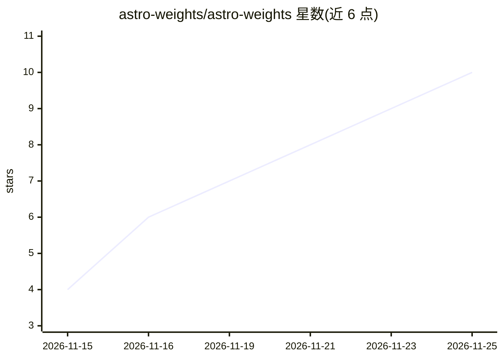

# astro-weights/astro-weights

⭐ 10 · Python · Apache-2.0 · 推送 2026-11-23 · [GitHub](https://github.com/astro-weights/astro-weights) · [官网](https://astro-weights.dev) · 个人维护

**对开源 LLM 权重做小型低秩编辑的工具库**

astro-weights 提供面向开源 LLM 权重编辑的 Python 工具集：从 numpy 配方构建低秩编辑并保存为带哈希校验的 PEFT LoRA 适配器，可写 GGUF 适配器供 llama.cpp 使用，支持在 transformers 模型上应用/移除编辑，并配套 paired comparison 评测与 difference-of-means 方向计算。0.2 版通过 stdio MCP 向 Claude Code 等 MCP 客户端提供 agent 工具，带预算限制与 OS 沙箱。README 标明为 pre-alpha，API 在 1.0 前可能变动。

## 筛选速览

| 维度 | 判定 | 备注 |
|---|---|---|
| AI 角色 | `ai-ecosystem` | LLM/agent 周边工具 |
| 许可风险 | `permissive` | Apache-2.0 |
| 部署形态 | `library` | 以包/库形式分发 |
| 模型依赖 | local-ok | 支持本地模型 |
| 硬件要求 | — | 无带数字的原话,不猜 |
| 安装摩擦 | `low` | 无编译、无系统依赖或容器化 |
| 成熟度 | `idea` | |

## 能力要点

- 低秩编辑保存为通用 LoRA 适配器，各推理栈可直接加载
- 支持导出 GGUF 适配器与 Hugging Face 模型卡
- 通过 stdio MCP 提供 agent 工具（预算限制 + OS 沙箱）
- 内置 base/edit 双臂 paired comparison 评测

## 适用场景

- 对开源模型做小型定向修正并导出 LoRA 适配器
- 通过 MCP 客户端以 agent 方式运行编辑会话
- 在 CPU 可运行的小模型上端到端练习权重编辑流程

## 场景标签

`模型评测` `微调` · 领域:评测与运维

## 证据(README 行号)

> L16: The goal is an agent that proposes small, targeted low-rank edits to a model's weights and keeps the ones that hold
> L24: LoRA is the output format because every serving stack already loads it (transformers, PEFT, vLLM, llama.cpp and the
> L70: The agent loop is new in 0.2 (`pip install "astro-weights[mcp,hf]"`). `astro-weights mcp RUN_DIR` serves the agent 

## 星数曲线

2026-11-15 4 → 2026-11-25 10（+6）

---
*卡片 v1 · prompt 1.4 · 生成 2026-11-20 · 置信度 high · 依据 README sha `3bf4df4879ee` · [字段定义](../../DATASET.md)*
