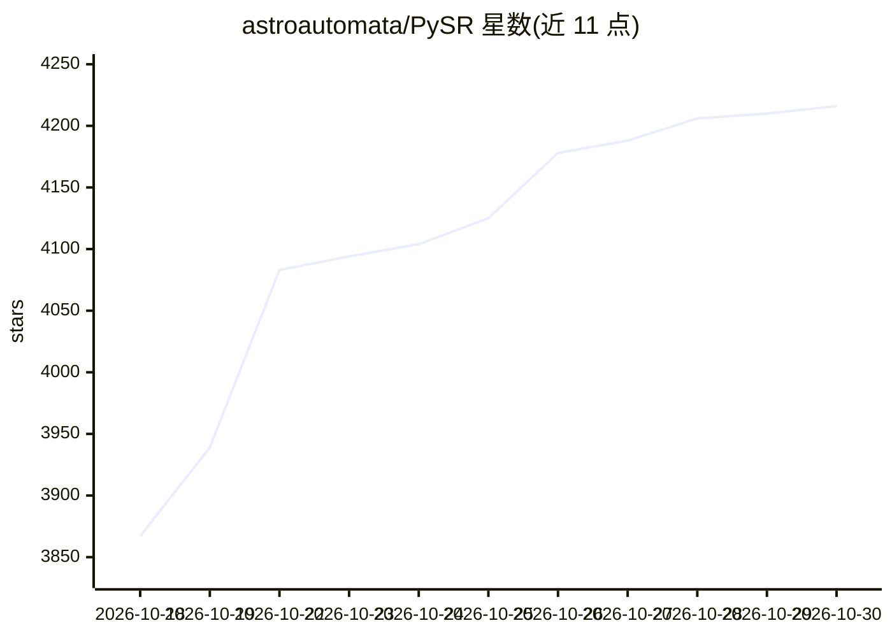

# astroautomata/PySR

⭐ 4,216 · Python · Apache-2.0 · 推送 2026-10-28 · [GitHub](https://github.com/astroautomata/PySR) · [官网](https://pysr.ai) · 个人维护

**符号回归库：从数据中搜索可解释的数学表达式**

PySR 是基于进化搜索的符号回归工具，目标是从数据集中找到优化目标函数的可解释符号表达式。主接口遵循 scikit-learn 风格（fit/predict），内部启动 Julia 进程进行多线程方程搜索，搜索引擎为配套的 SymbolicRegression.jl。学到的方程可导出为 SymPy、JAX、PyTorch 等格式，支持去噪、特征选择、warm_start 断点续搜、模型保存加载（hall_of_fame.pkl）。提供 pip/conda 安装、Docker/Apptainer 容器与 npx skills 的 AI agent 技能安装方式。适用于低维数据集，也支持对神经网络的符号蒸馏。

## 筛选速览

| 维度 | 判定 | 备注 |
|---|---|---|
| AI 角色 | `ai-native` | 本体是模型或模型工具 |
| 许可风险 | `permissive` | Apache-2.0 |
| 部署形态 | `self-host` | docker 或自建部署 |
| 模型依赖 | — | README 未给出锁定关系 |
| 硬件要求 | — | 无带数字的原话,不猜 |
| 安装摩擦 | `low` | 无编译、无系统依赖或容器化 |
| 成熟度 | — | 结构信号不足 |

## 能力要点

- scikit-learn 风格接口，内部 Julia 多线程进化搜索方程
- 方程导出为 SymPy/JAX/PyTorch 格式（可微分）
- 支持去噪、特征选择、warm_start 断点续搜与模型保存加载
- 提供 Docker/Apptainer 容器与 AI agent 技能安装（npx skills）

## 适用场景

- 从实验数据中发现可解释的解析表达式
- 将神经网络蒸馏为解析方程以解释模型
- 在集群无 root 环境用 Apptainer 容器运行符号回归

## 场景标签

 · 领域:机器学习/科学计算

## 证据(README 行号)

> L20: PySR is an open-source tool for *Symbolic Regression*: a machine learning
> L26: PySR is developed alongside the Julia library SymbolicRegression.jl,

## 星数曲线

2026-10-18 3,867 → 2026-10-30 4,216（+349）

---
*卡片 v1 · prompt 1.4 · 生成 2026-10-20 · 置信度 mid · 依据 README sha `4db1f7f785d2` · [字段定义](../../DATASET.md)*
