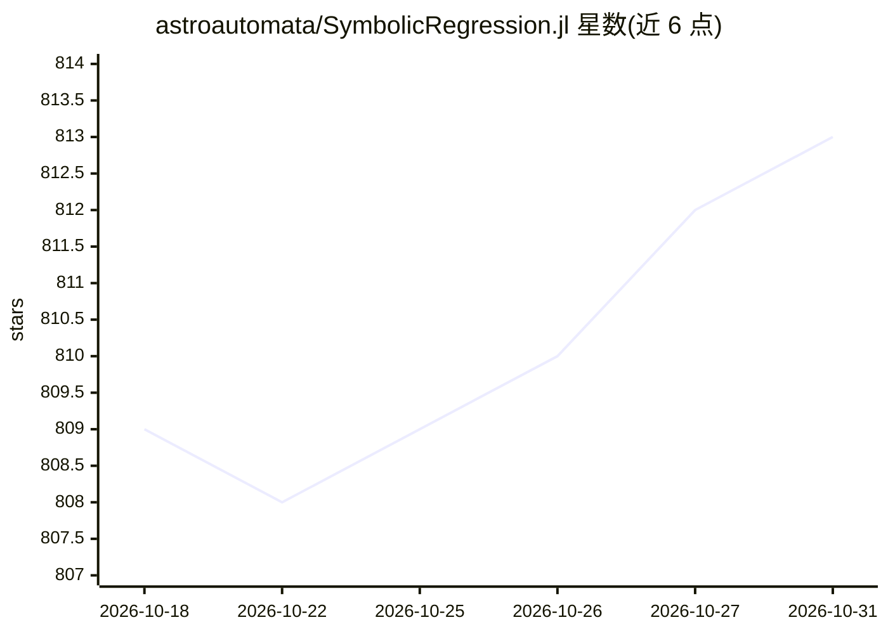

# astroautomata/SymbolicRegression.jl

⭐ 813 · Julia · Apache-2.0 · 推送 2026-10-25 · [GitHub](https://github.com/astroautomata/SymbolicRegression.jl) · [官网](https://julia.pysr.ai) · 个人维护

**Julia 符号回归库：搜索优化目标的解析表达式**

Julia 编写的分布式高性能符号回归库：对数据搜索使特定目标最优的符号表达式（解析函数形式）。提供 SRRegressor 高层接口（fit!/predict/report，兼容 MLJ 生态）与 equation_search 底层接口，以帕累托前沿（精度-复杂度）组织候选表达式，表达式基于 DynamicExpressions.jl 的 Node/Expression 类型、可直接调用求值，并可导出到 SymbolicUtils.jl 做符号化简。支持多输出回归（MultitargetSRRegressor）。安装方式为 Julia Pkg.add。

## 筛选速览

| 维度 | 判定 | 备注 |
|---|---|---|
| AI 角色 | `ai-native` | 本体是模型或模型工具 |
| 许可风险 | `permissive` | Apache-2.0 |
| 部署形态 | `None` |  |
| 模型依赖 | — | README 未给出锁定关系 |
| 硬件要求 | — | 无带数字的原话,不猜 |
| 安装摩擦 | `low` | 无编译、无系统依赖或容器化 |
| 成熟度 | — | 结构信号不足 |

## 能力要点

- 搜索优化特定目标的符号表达式，输出精度-复杂度帕累托前沿
- SRRegressor 接口兼容 MLJ 生态（pipelines、tuning）
- 表达式对象可直接调用求值，支持 Float32/Float64 常量类型转换
- 可导出到 SymbolicUtils.jl 进行符号化简

## 适用场景

- 从数据中发现可解释的解析公式
- 科学建模中做方程发现（equation discovery）
- 在 MLJ 流水线中嵌入符号回归并调参

## 场景标签

`科研工具` · 领域:学习与行业

## 证据(README 行号)

> L1: SymbolicRegression.jl searches for symbolic expressions which optimize a particular objective.
> L105: The heart of SymbolicRegression.jl is the

## 星数曲线

2026-10-18 809 → 2026-10-31 813（+4）

---
*卡片 v1 · prompt 1.4 · 生成 2026-10-21 · 置信度 high · 依据 README sha `8e2ae5af9069` · [字段定义](../../DATASET.md)*
