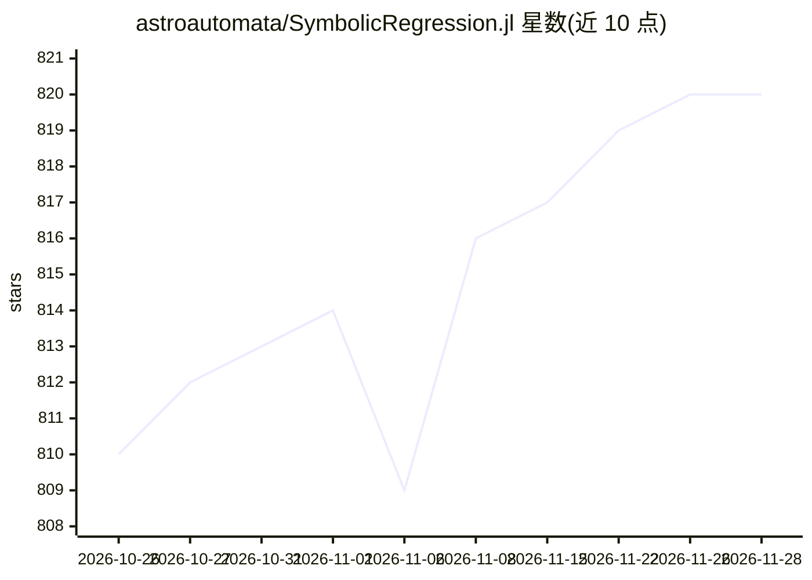

# astroautomata/SymbolicRegression.jl

⭐ 820 · Julia · Apache-2.0 · 推送 2026-11-27 · [GitHub](https://github.com/astroautomata/SymbolicRegression.jl) · [官网](https://julia.pysr.ai) · 个人维护

**Julia 符号回归库：从数据搜索优化目标的符号表达式**

用进化搜索在数据上寻找优化给定目标的符号表达式，输出按精度-复杂度组织的 Pareto 前沿方程组；提供 SRRegressor（兼容 MLJ 的 machine/fit!/predict 接口）、多目标输出的 MultitargetSRRegressor 以及底层 equation_search 函数。输入支持矩阵、NamedTuple 或 Tables.jl 兼容表格；表达式可转换为 SymbolicUtils.jl 形式做化简与打印。通过 Julia Pkg 安装，文档与论文另行提供。

## 筛选速览

| 维度 | 判定 | 备注 |
|---|---|---|
| AI 角色 | `ai-native` | 本体是模型或模型工具 |
| 许可风险 | `permissive` | Apache-2.0 |
| 部署形态 | `None` |  |
| 模型依赖 | — | README 未给出锁定关系 |
| 硬件要求 | — | 无带数字的原话,不猜 |
| 安装摩擦 | `low` | 无编译、无系统依赖或容器化 |
| 成熟度 | — | 结构信号不足 |

## 能力要点

- 搜索并返回 Pareto 前沿上的符号表达式（精度与复杂度权衡）
- SRRegressor 接入 MLJ 生态（pipelines、tuning）
- 支持多输出回归 MultitargetSRRegressor
- 表达式可导出至 SymbolicUtils.jl 并可直接对数据调用求值

## 适用场景

- 从观测数据中发现解析形式的数学方程
- 为表格数据训练可解释的回归模型
- 在 MLJ 管线中集成符号回归步骤

## 场景标签

`数据分析` · 领域:效率与自动化

## 证据(README 行号)

> L1: SymbolicRegression.jl searches for symbolic expressions which optimize a particular objective.
> L71: Finally, we can make predictions with the expressions
> L108: to model a 1D array using analytic functional forms.

## 星数曲线

2026-10-26 810 → 2026-11-28 820（+10）

---
*卡片 v1 · prompt 1.4 · 生成 2026-11-24 · 置信度 high · 依据 README sha `9173a8355a70` · [字段定义](../../DATASET.md)*
