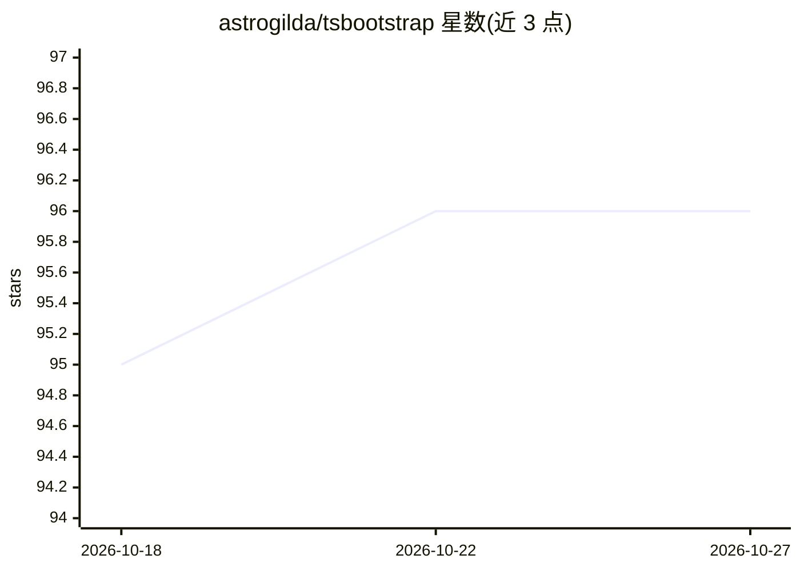

# astrogilda/tsbootstrap

⭐ 96 · Python · MIT · 推送 2026-10-24 · [GitHub](https://github.com/astrogilda/tsbootstrap) · [官网](https://tsbootstrap.readthedocs.io/en/latest/) · 组织维护

**时间序列与参差面板的块自助重采样与不确定性量化库**

Python 统计库，提供单一类型化入口 bootstrap()，覆盖 IID、移动/循环/平稳/非重叠/锥形块、递归 AR/ARIMA/VAR/筛法及 wild 重采样；结果携带溯源元数据与 OOB/IB 原语。uq 层输出置信区间（percentile/basic/studentized/BCa）、AR 预测带与 EnbPI/自适应保形校准。面板 API 支持不等长序列，可选编译后端在统计量归约时融合生成重采样以控制峰值内存。另附只读 MCP 服务器供 LLM 客户端诊断序列并计算置信区间（≤500 观测）。需 Python 3.10+。

## 筛选速览

| 维度 | 判定 | 备注 |
|---|---|---|
| AI 角色 | `ai-native` | 本体是模型或模型工具 |
| 许可风险 | `permissive` | MIT |
| 部署形态 | `library` | 以包/库形式分发 |
| 模型依赖 | — | README 未给出锁定关系 |
| 硬件要求 | — | 无带数字的原话,不猜 |
| 安装摩擦 | `low` | 无编译、无系统依赖或容器化 |
| 成熟度 | — | 结构信号不足 |

## 能力要点

- 块/模型/wild 三类重采样方法经同一类型化 bootstrap() 入口调用
- uq 层提供置信区间、AR 预测带与 EnbPI/ACI/AgACI/NexCP 保形校准
- 面板 API 支持不等长序列，流式归约路径无需物化重采样张量
- 只读 MCP 服务器：LLM 客户端可直接诊断序列并计算置信区间

## 适用场景

- 为自相关时间序列计算不过度乐观的置信区间
- 用 EnbPI/保形方法为 sklearn 风格回归器生成预测区间
- 一次处理上万条不等长面板序列的统计量分布
- 让 AI agent 通过 MCP 工具免写代码做序列诊断与区间估计

## 场景标签

 · 领域:时间序列统计/不确定性量化

## 证据(README 行号)

> L34: `tsbootstrap` makes the sampling design explicit through typed method specifications,
> L52: |Uncertainty workflows|Bootstrap confidence intervals, AR forecast bands, EnbPI and adaptive conformal calibration|
> L107: The `uq` layer turns resampled series into prediction intervals. `forecast_intervals`

## 星数曲线

2026-10-18 95 → 2026-10-27 96（+1）

---
*卡片 v1 · prompt 1.4 · 生成 2026-10-23 · 置信度 high · 依据 README sha `923656db0ece` · [字段定义](../../DATASET.md)*
