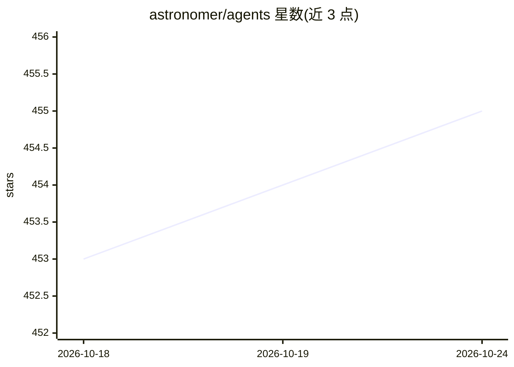

# astronomer/agents

⭐ 455 · Python · Apache-2.0 · 推送 2026-10-14 · [GitHub](https://github.com/astronomer/agents) · [官网](https://astronomer.io) · 组织维护

**为数据工程工作流提供 Airflow MCP 服务器、CLI 与 AI 编码代理技能**

Astronomer 维护的数据工程 AI 代理工具集：包含面向 Airflow 的 MCP 服务器（astro-airflow-mcp，覆盖 DAG 管理、触发、任务日志、健康检查）、终端 CLI 工具 af，以及一组扩展 AI 编码代理的技能——数仓 schema 发现、SQL 分析、数据血缘追踪、DAG 编写/测试/调试、dbt Cosmos 集成、Airflow 2→3 迁移等。兼容 Claude Code、Cursor 等 25+ 编码代理与任意 MCP 客户端；开源 Airflow 2.x/3.x 可用，也支持 Astro 托管平台。Apache 2.0 许可。

## 筛选速览

| 维度 | 判定 | 备注 |
|---|---|---|
| AI 角色 | `ai-ecosystem` | LLM/agent 周边工具 |
| 许可风险 | `permissive` | Apache-2.0 |
| 部署形态 | `self-host` | docker 或自建部署 |
| 模型依赖 | — | README 未给出锁定关系 |
| 硬件要求 | — | 无带数字的原话,不猜 |
| 安装摩擦 | `low` | 无编译、无系统依赖或容器化 |
| 成熟度 | — | 结构信号不足 |

## 能力要点

- Airflow MCP 服务器覆盖 DAG 管理、触发、任务日志与健康检查
- 20+ 个技能：数仓分析、血缘追踪、DAG 开发调试、dbt 集成、版本迁移
- af CLI 直接在终端操作 Airflow（匿名遥测可关闭）
- 支持 Snowflake/BigQuery/PostgreSQL 及 25+ SQLAlchemy 数据库自动探测驱动

## 适用场景

- 让 Claude Code 或 Cursor 代理直接管理、编写和调试 Airflow DAG
- 用自然语言查询数仓、做表画像与数据新鲜度检查
- 在 AI 辅助下完成 Airflow 2.x 到 3.x 的迁移

## 场景标签

`编码 Agent` `数据分析` · 领域:效率与自动化

## 证据(README 行号)

> L3: AI agent tooling for data engineering workflows. Includes an MCP server for Airflow, a CLI tool (`af`) for interacti
> L42: The plugin includes the Airflow MCP server that runs via `uvx` from PyPI. Data warehouse queries are handled by the
> L100: ### MCP Server

## 星数曲线

2026-10-18 453 → 2026-10-24 455（+2）

---
*卡片 v1 · prompt 1.4 · 生成 2026-10-21 · 置信度 mid · 依据 README sha `d14f488c2162` · [字段定义](../../DATASET.md)*
