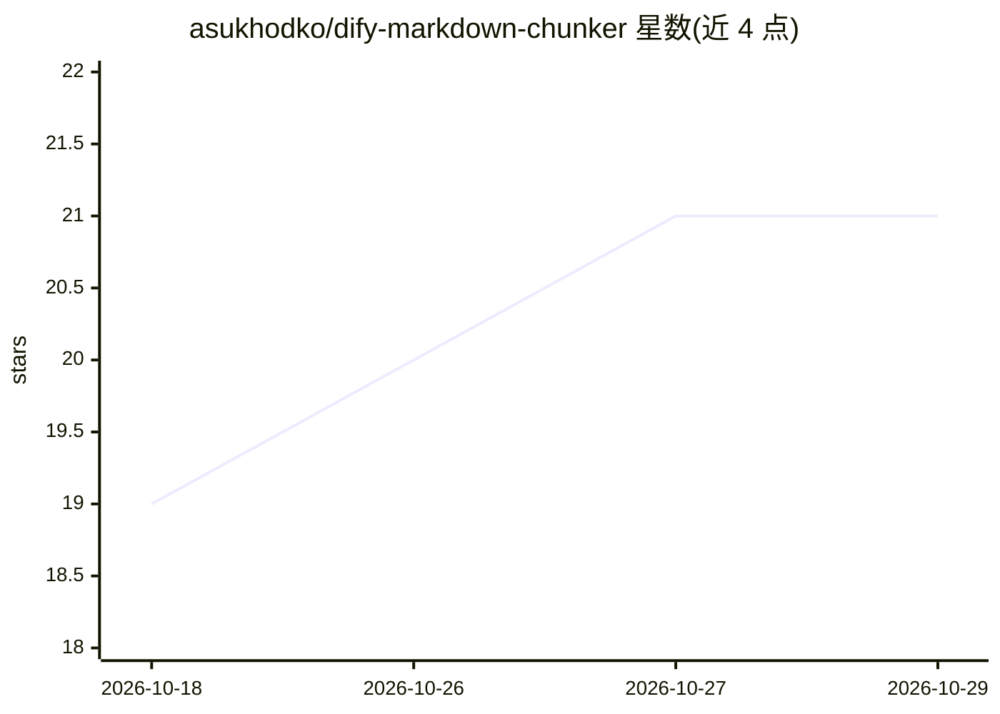

# asukhodko/dify-markdown-chunker

⭐ 21 · Python · MIT · 推送 2026-01-12 · [GitHub](https://github.com/asukhodko/dify-markdown-chunker) · 个人维护

**Dify 平台的 Markdown 结构感知分块插件，服务 RAG 知识库**

面向 Dify RAG 工作流的文档分块插件，底层基于 chunkana 引擎：通过 Markdown AST 解析与内容类型检测，在 code_aware/list_aware/structural/fallback 四种策略中自动选择，保持代码块、表格、列表、LaTeX 公式的完整性；每个分块可内嵌 header_path、行号等元数据以辅助检索。支持层级分块、流式处理大文件（>10MB 文件 <50MB 内存）、自适应分块大小与相邻表格分组。以 .difypkg 文件在 Dify（1.9.0+）中安装，也可作为 Python 库使用；全部本地处理，不外传数据。不适合无结构短文本。

## 筛选速览

| 维度 | 判定 | 备注 |
|---|---|---|
| AI 角色 | `ai-ecosystem` | LLM/agent 周边工具 |
| 许可风险 | `permissive` | MIT |
| 部署形态 | `None` |  |
| 模型依赖 | — | README 未给出锁定关系 |
| 硬件要求 | — | 无带数字的原话,不猜 |
| 安装摩擦 | `low` | 无编译、无系统依赖或容器化 |
| 成熟度 | — | 结构信号不足 |

## 能力要点

- 基于 AST 的 4 种自适应分块策略（code_aware/list_aware/structural/fallback）
- 分块内嵌元数据（header_path、行号、内容类型）提升向量检索质量
- 层级分块与流式处理（>10MB 文件 <50MB 内存）
- LaTeX 公式、嵌套代码围栏、相邻表格保持完整

## 适用场景

- 在 Dify 知识库中分块技术/API 文档用于 RAG 检索
- 为含表格、列表、公式的结构化文档做语义分块
- 微调模型前获取不带元数据的干净分块文本（include_metadata=false）

## 场景标签

`RAG` `文档解析` · 领域:知识与检索

## 证据(README 行号)

> L17: Advanced Markdown Chunker is a Dify plugin that intelligently splits Markdown documents into semantically meaningfu
> L21: This plugin is designed specifically for **RAG (Retrieval-Augmented Generation)** workflows where document chunks a
> L88: - **Dify Plugin** — ready-to-use in Dify workflows

## 星数曲线

2026-10-18 19 → 2026-10-29 21（+2）

---
*卡片 v1 · prompt 1.4 · 生成 2026-10-28 · 置信度 high · 依据 README sha `43fd673dd574` · [字段定义](../../DATASET.md)*
