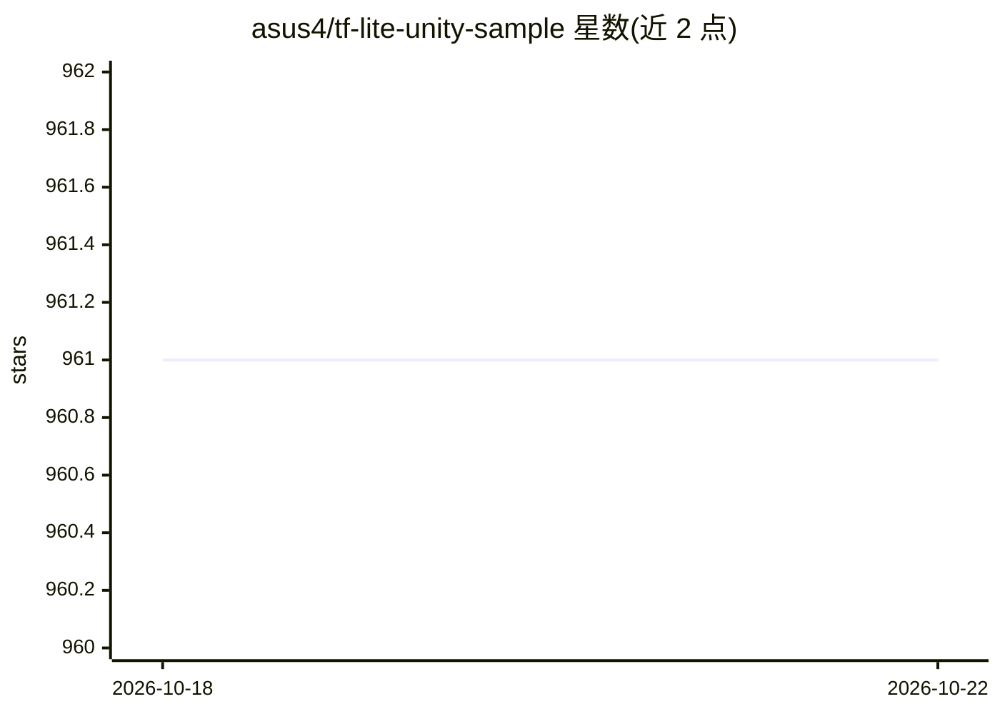

# asus4/tf-lite-unity-sample

⭐ 961 · C# · 推送 2026-05-28 · [GitHub](https://github.com/asus4/tf-lite-unity-sample) · 个人维护

**TensorFlow Lite 与 MediaPipe 在 Unity 中的示例与插件**

将 TensorFlow Lite 官方示例移植到 Unity 并附工具库：包含 MNIST、EfficientDet 目标检测、DeepLab、MoveNet、Style Transfer、BERT 问答、音频分类等 TensorFlow 示例，以及 MediaPipe 的手势/人脸/姿态/自拍分割示例。通过 UPM scoped registry 以包形式提供预编译 TFLite 库，覆盖 iOS/Android/macOS/Ubuntu/Windows 五平台，支持 Metal、GPU、NNAPI delegate，也可用脚本自行编译最新 TFLite 库。面向在 Unity 中接入端侧模型推理的开发者。

## 筛选速览

| 维度 | 判定 | 备注 |
|---|---|---|
| AI 角色 | `ai-ecosystem` | LLM/agent 周边工具 |
| 许可风险 | `none` | — |
| 部署形态 | `None` |  |
| 模型依赖 | — | README 未给出锁定关系 |
| 硬件要求 | — | 无带数字的原话,不猜 |
| 安装摩擦 | `low` | 无编译、无系统依赖或容器化 |
| 成熟度 | — | 结构信号不足 |

## 能力要点

- 移植 TensorFlow Lite 官方示例到 Unity（MNIST/目标检测/DeepLab/BERT 问答等）
- 包含 MediaPipe 手势追踪、人脸网格、全身姿态、自拍分割示例
- 通过 UPM 包分发预编译库，覆盖 iOS/Android/macOS/Ubuntu/Windows
- 支持 Metal/GPU/NNAPI delegate，可用脚本自行构建最新 TFLite 库

## 适用场景

- 在 Unity 项目中运行端侧模型推理
- 学习 TFLite/MediaPipe 模型在移动与桌面平台的接入方式
- 快速体验手势追踪、姿态识别等 CV 示例

## 场景标签

`目标检测` `推理引擎` · 领域:感知与多模态

## 证据(README 行号)

> L5: Porting of "TensorFlow Lite Examples" and some utilities for Unity.
> L32: Included prebuilt libraries:

## 星数曲线

2026-10-18 961 → 2026-10-22 961（+0）

---
*卡片 v1 · prompt 1.4 · 生成 2026-10-21 · 置信度 high · 依据 README sha `8d03e598db13` · [字段定义](../../DATASET.md)*
