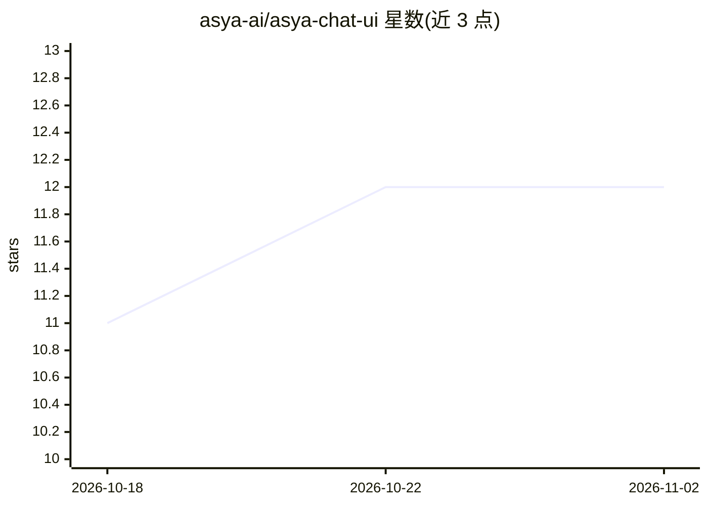

# asya-ai/asya-chat-ui

⭐ 12 · Python · GPL-3.0 · 推送 2026-10-30 · [GitHub](https://github.com/asya-ai/asya-chat-ui) · 组织维护

**自托管多提供商 LLM 聊天平台，带组织管理与 OpenAI 兼容 API**

全栈自托管 LLM 聊天应用：支持多组织与角色权限、组织级模型/提供商管理，后端覆盖 OpenAI、Azure OpenAI、Gemini、Groq、Anthropic、OpenRouter、Vertex。Worker 基于 LangChain 运行 agent 循环，支持流式生成、并行工具调用（网页搜索/抓取、沙箱代码执行、PDF、图像生成）、RAG 项目、用户记忆与用量统计，并对外提供 OpenAI 兼容端点。服务以 Docker Compose 编排（nginx/FastAPI/Celery/Postgres/Redis 等），GPLv3 许可，由 asya.ai 维护。

## 筛选速览

| 维度 | 判定 | 备注 |
|---|---|---|
| AI 角色 | `ai-native` | 本体是模型或模型工具 |
| 许可风险 | `viral` | GPL-3.0 |
| 部署形态 | `self-host` | docker 或自建部署 |
| 模型依赖 | — | README 未给出锁定关系 |
| 硬件要求 | — | 无带数字的原话,不猜 |
| 安装摩擦 | `low` | 无编译、无系统依赖或容器化 |
| 成熟度 | — | 结构信号不足 |

## 能力要点

- 多组织角色管理与按组织启停模型/提供商
- OpenAI 兼容 API 端点（/v1/models、/v1/chat/completions、/v1/embeddings）
- RAG 项目、用户记忆、沙箱代码执行与网页搜索等内置工具
- 组织级数据保留策略与按模型/用户/组织/月的用量统计

## 适用场景

- 团队或组织自建带权限管理的 LLM 聊天服务
- 作为 OpenAI 兼容网关统一管理多家提供商
- 搭建带 RAG 文档检索与工具执行的知识问答平台

## 场景标签

`聊天机器人` `RAG` · 领域:对话与助手

## 证据(README 行号)

> L3: Open source multi-provider LLM chat platform with organization management, model routing, tool execution, usage anal
> L28: `asya-chat-ui` is a full-stack chat application that supports:
> L33: - streaming chat generation with resumable task events and parallel tool calling

## 星数曲线

2026-10-18 11 → 2026-11-02 12（+1）

---
*卡片 v1 · prompt 1.4 · 生成 2026-11-01 · 置信度 high · 依据 README sha `1071a73ca6e5` · [字段定义](../../DATASET.md)*
