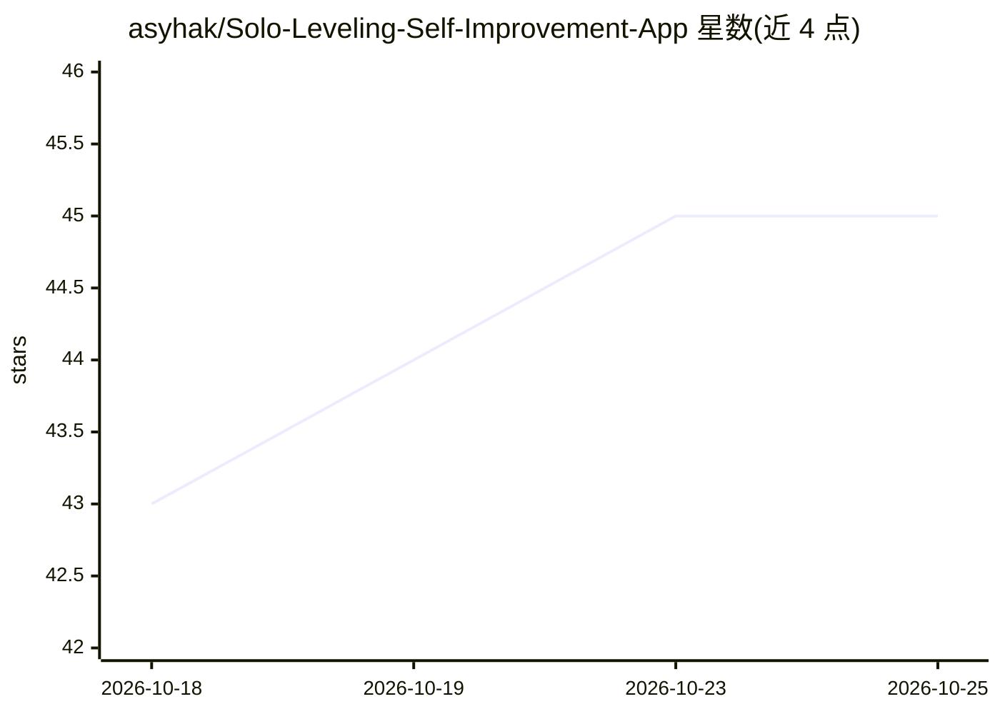

# asyhak/Solo-Leveling-Self-Improvement-App

⭐ 45 · TypeScript · 推送 2026-01-11 · [GitHub](https://github.com/asyhak/Solo-Leveling-Self-Improvement-App) · [官网](https://v0-dark-fantasy-self-improvement.vercel.app) · 个人维护

**游戏化自我提升应用：将个人目标转化为 RPG 任务与战斗**

受《Solo Leveling》漫画启发的游戏化自我提升 Web 应用：用户创建与现实目标绑定的自定义任务（E 到 S 级难度），完成任务获得 XP、属性点、金币与物品，通过回合制战斗、装备与稀有度系统构建角色成长反馈循环。AI 部分为基于 OpenAI GPT-3.5 Turbo 与 Google Gemini 2.0 Flash 的任务生成，并分析任务描述以分配难度与奖励，可在两家模型间切换。技术栈为 Next.js/React/TypeScript，通过 git clone 与 pnpm 运行。

## 筛选速览

| 维度 | 判定 | 备注 |
|---|---|---|
| AI 角色 | `ai-enhanced` | 去掉 AI 部分产品仍成立 |
| 许可风险 | `none` | — |
| 部署形态 | `library` | 以包/库形式分发 |
| 模型依赖 | — | README 未给出锁定关系 |
| 硬件要求 | — | 无带数字的原话,不猜 |
| 安装摩擦 | `low` | 无编译、无系统依赖或容器化 |
| 成熟度 | — | 结构信号不足 |

## 能力要点

- 任务难度 E 到 S 级，与现实目标绑定并给予 XP/属性/金币/物品奖励
- AI 任务生成（OpenAI GPT-3.5 Turbo 与 Google Gemini 2.0 Flash，可切换）
- 5 项核心属性的回合制战斗与装备稀有度系统

## 适用场景

- 把健身、学习等现实目标转成游戏任务来坚持完成
- 通过角色成长和战斗奖励获得完成任务的动力

## 场景标签

 · 领域:生活方式/游戏化自我提升

## 证据(README 行号)

> L7: Solo Leveling - Self-Improvement App is a gamified self-improvement application that transforms personal development
> L37: - AI-powered quest generation using OpenAI's GPT and Google's Gemini

## 星数曲线

2026-10-18 43 → 2026-10-25 45（+2）

---
*卡片 v1 · prompt 1.4 · 生成 2026-10-25 · 置信度 mid · 依据 README sha `6be95eea67b3` · [字段定义](../../DATASET.md)*
