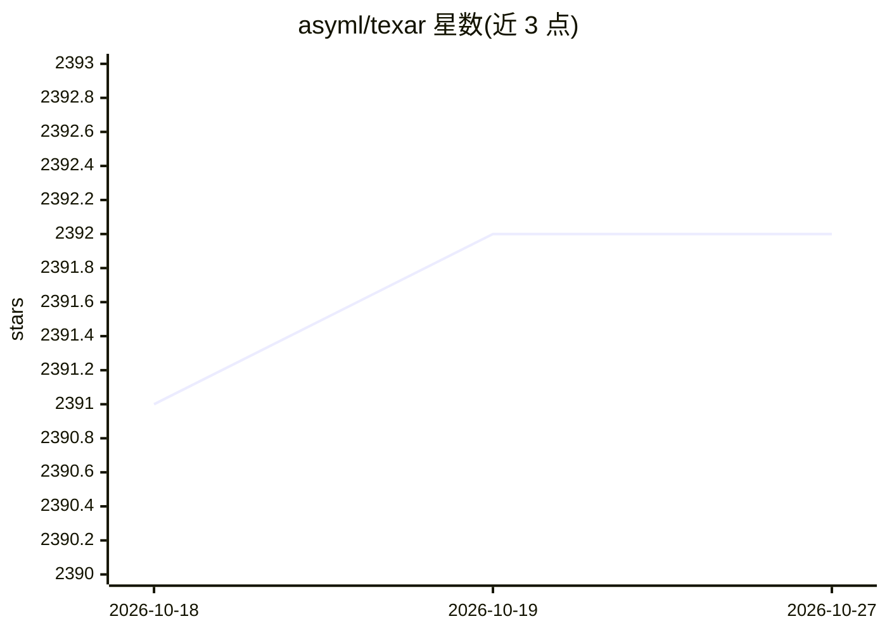

# asyml/texar

⭐ 2,392 · Python · Apache-2.0 · 推送 2026-07-21 · [GitHub](https://github.com/asyml/texar) · [官网](https://asyml.io) · 组织维护

**TensorFlow 版机器学习/NLP/文本生成模块化工具库**

Texar 是面向研究人员与从业者的机器学习工具库，本仓库为 TensorFlow 版本（另维护接口基本相同的 Texar-PyTorch）。提供可组合的模块化 ML 组件库，覆盖编码器-解码器、注意力、分类器等模型结构，以及最大似然、强化学习、对抗学习等算法，内置 BERT、GPT2、XLNet 等预训练模型接入。要求 Python 3.6/3.7、tensorflow>=1.10.0(<2.0.0)，通过 PyPI 或源码安装。由 Petuum 与 CMU 等机构协作开发。

## 筛选速览

| 维度 | 判定 | 备注 |
|---|---|---|
| AI 角色 | `ai-ecosystem` | LLM/agent 周边工具 |
| 许可风险 | `permissive` | Apache-2.0 |
| 部署形态 | `library` | 以包/库形式分发 |
| 模型依赖 | — | README 未给出锁定关系 |
| 硬件要求 | — | 无带数字的原话,不猜 |
| 安装摩擦 | `low` | 无编译、无系统依赖或容器化 |
| 成熟度 | — | 结构信号不足 |

## 能力要点

- 模块化组件库，支持自定义组合模型与算法
- 统一接口使用 BERT、GPT2、XLNet 等预训练模型
- 支持最大似然、强化学习、对抗学习等多种训练方式
- 支持多 GPU 分布式训练

## 适用场景

- 研究者快速搭建与实验文本生成、机器翻译、对话系统等模型
- 在统一接口下复用预训练模型构建编码/分类/生成任务
- 在 TF 与 PyTorch 两个版本间以相近接口切换开发

## 场景标签

 · 领域:机器学习/NLP 工具库

## 证据(README 行号)

> L7: **Texar** is a toolkit aiming to support a broad set of machine learning, especially natural language processing and
> L17: * **Rich Pre-trained Models, Rich Usage with Uniform Interfaces**. BERT, GPT2, XLNet, etc, for encoding, classifica
> L20: * **Versatile** to support broad tasks, models, algorithms, data processing, evaluation, etc.

## 星数曲线

2026-10-18 2,391 → 2026-10-27 2,392（+1）

---
*卡片 v1 · prompt 1.4 · 生成 2026-10-21 · 置信度 high · 依据 README sha `fd7eb9791c1c` · [字段定义](../../DATASET.md)*
