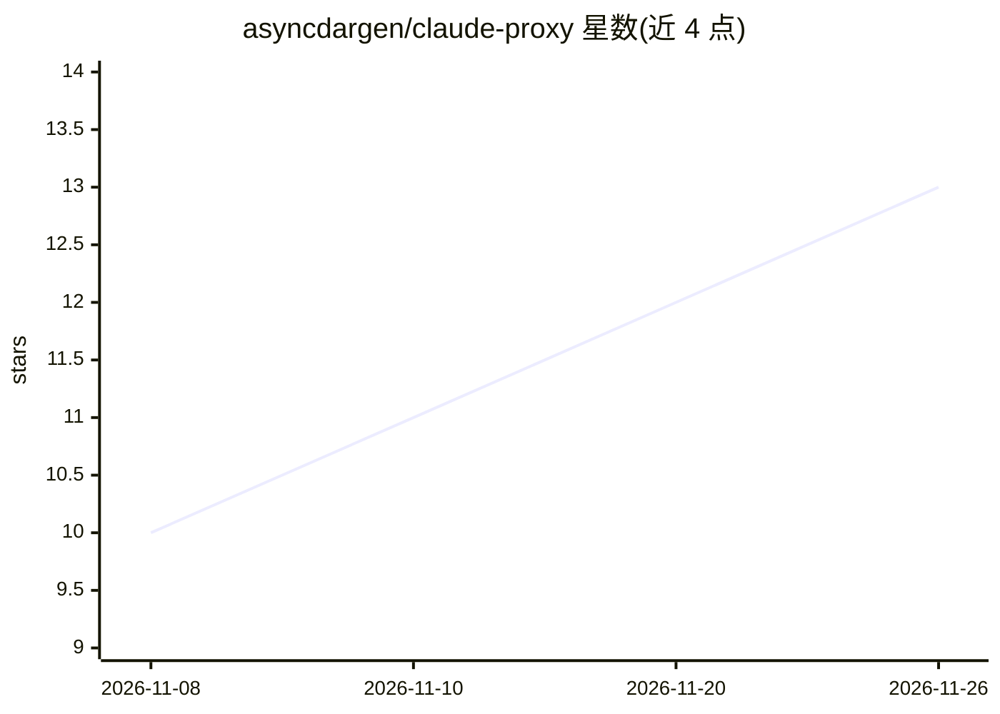

# asyncdargen/claude-proxy

⭐ 13 · Kotlin · MIT · 推送 2026-11-18 · [GitHub](https://github.com/asyncdargen/claude-proxy) · 个人维护

**自托管多账号轮换代理：管理自己的 Anthropic 账号池**

自托管的 Anthropic 账号池代理基础设施：存储多个账号（OAuth 订阅与 API key），按优先级轮换并跟踪速率限制窗口，全部饱和时按 opt-in fallback 继续服务；同一账号池通过 Claude Code 数据路径与 OpenAI/Anthropic 兼容两个路由网关暴露，供 SDK、agent 框架、IDE 插件接入；提供每用户/每 token 统计、每日美元限额、AES-256-GCM 加密存储与 React 管理 UI。以 Docker Compose 多镜像栈分发（Kotlin 服务 + Go 网关 + nginx web）。README 提示与第三方共享访问可能违反 Anthropic 条款。

## 筛选速览

| 维度 | 判定 | 备注 |
|---|---|---|
| AI 角色 | `ai-ecosystem` | LLM/agent 周边工具 |
| 许可风险 | `permissive` | MIT |
| 部署形态 | `self-host` | docker 或自建部署 |
| 模型依赖 | locked-api |  |
| 硬件要求 | — | 无带数字的原话,不猜 |
| 安装摩擦 | `low` | 无编译、无系统依赖或容器化 |
| 成熟度 | — | 结构信号不足 |

## 能力要点

- 按优先级轮换账号，基于 anthropic-ratelimit-unified 响应头做实时窗口跟踪
- OpenAI Chat Completions 与 Anthropic Messages 两个兼容路由网关
- 多用户角色权限、每用户每日美元限额、MCP 工具调用计数
- 429/401/5xx 跨账号透明重试与流中 failover

## 适用场景

- 将多个 Anthropic 账号汇成一个池供团队 Claude Code 使用
- 为内部 OpenAI 兼容客户端提供统一 base_url 与独立限额
- 跟踪每个用户/ token 的花费与速率窗口消耗

## 场景标签

 · 领域:LLM 基础设施/API 网关

## 证据(README 行号)

> L12: Beyond the Claude Code datapath, the same account pool is exposed through two **API routing
> L13: gateways** — an OpenAI Chat Completions endpoint and a native Anthropic Messages endpoint — so

## 星数曲线

2026-11-08 10 → 2026-11-26 13（+3）

---
*卡片 v1 · prompt 1.4 · 生成 2026-11-18 · 置信度 mid · 依据 README sha `f76edf33dc79` · [字段定义](../../DATASET.md)*
