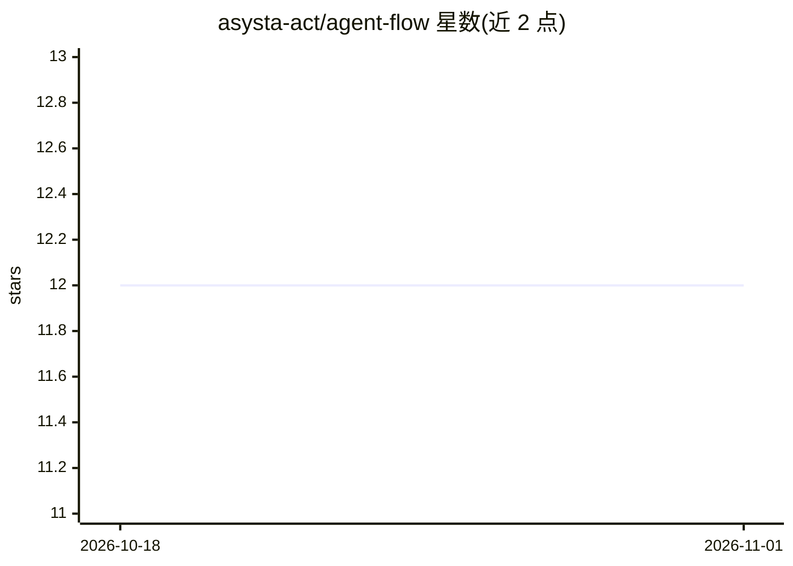

# asysta-act/agent-flow

⭐ 12 · Shell · MIT · 推送 2026-07-06 · [GitHub](https://github.com/asysta-act/agent-flow) · 个人维护

**Claude Code 插件：用 17 个 AI agent 自动化修 bug/开发/脚手架流程**

面向 Claude Code 用户的插件，以纯 Markdown 定义的 17 个专职 agent 与 17 个技能命令，自动化从 issue 追踪查询到修复、评审、测试、发 PR 的完整流程；另含特性流水线、自然语言项目脚手架、backlog/冲刺规划与无头 CI 调度。零依赖、跨平台（Windows 需 Git Bash），通过 marketplace 命令安装，项目需在 CLAUDE.md 中配置 Automation Config。

## 筛选速览

| 维度 | 判定 | 备注 |
|---|---|---|
| AI 角色 | `ai-ecosystem` | LLM/agent 周边工具 |
| 许可风险 | `permissive` | MIT |
| 部署形态 | `None` |  |
| 模型依赖 | — | README 未给出锁定关系 |
| 硬件要求 | — | 无带数字的原话,不猜 |
| 安装摩擦 | `low` | 无编译、无系统依赖或容器化 |
| 成熟度 | — | 结构信号不足 |

## 能力要点

- 17 个 agent 各有角色、模型指派（opus/sonnet/haiku）与约束
- bug-fix/feature/scaffold 三条流水线，支持 --yolo 与 --step-mode
- 纯 Markdown 定义、零依赖、无构建系统
- 支持 6 种 issue tracker、钩子集成点与流水线 profile

## 适用场景

- 批量修 issue 并自动走完评审测试到 PR 合并
- 从自然语言描述生成带测试与 CI 的项目骨架
- 在 cron/CI 中无人值守跑修复与特性流水线

## 场景标签

`编码 Agent` `代码生成` · 领域:编码与开发

## 证据(README 行号)

> L5: A Claude Code plugin that automates the full development lifecycle — from bug triage through fix, review, test, and 
> L19: - **17 specialized agents** — Each with a defined role, model assignment (opus/sonnet/haiku), and constraints. Read

## 星数曲线

2026-10-18 12 → 2026-11-01 12（+0）

---
*卡片 v1 · prompt 1.4 · 生成 2026-11-01 · 置信度 high · 依据 README sha `a37d51f7d494` · [字段定义](../../DATASET.md)*
