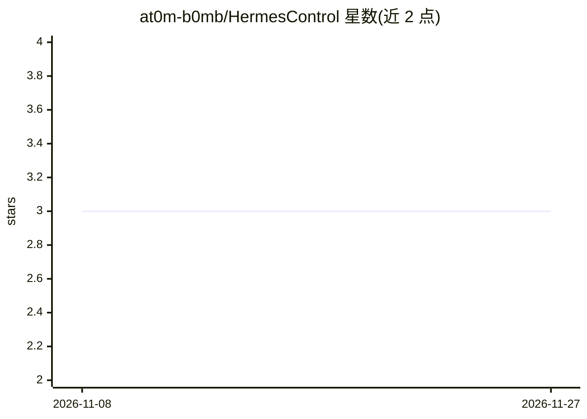

# at0m-b0mb/HermesControl

⭐ 3 · Python · MIT · 推送 2026-11-20 · [GitHub](https://github.com/at0m-b0mb/HermesControl) · [官网](https://at0m-b0mb.github.io/HermesControl/) · 个人维护

**Nous Hermes Agent 的桌面控制面板：隔离安装并管理全部配置**

基于 PySide6 的桌面控制面板，用于安装、隔离运行和管理 Nous Research 的 Hermes Agent。核心机制：安装到独立目录并显式传递 HERMES_HOME 避免与既有安装冲突；从本机安装自带的 config.yaml 派生约 240 项配置的模式；对本地模型预检 64K 上下文窗口与工具调用支持，并在下载后实测窗口大小。提供流式对话、工具调用审计（识别未实际执行工具的回答）、上下文压缩进度条与本地模型工具使用基准脚本。

## 筛选速览

| 维度 | 判定 | 备注 |
|---|---|---|
| AI 角色 | `ai-ecosystem` | LLM/agent 周边工具 |
| 许可风险 | `permissive` | MIT |
| 部署形态 | `None` |  |
| 模型依赖 | local-ok | 支持本地模型 |
| 硬件要求 | — | 无带数字的原话,不猜 |
| 安装摩擦 | `low` | 无编译、无系统依赖或容器化 |
| 成熟度 | — | 结构信号不足 |

## 能力要点

- 从本机安装的 config.yaml 派生配置模式，覆盖约 240 项选项
- 本地模型预检：64K 上下文下限、工具调用支持、LM Studio 加载窗口修正
- 工具调用审计：识别声称已保存但未实际调用工具的回答
- 附带 model_bench.py / tool_check.py 本地模型工具使用基准

## 适用场景

- 在同一台机器上隔离安装多个 Hermes Agent 实例
- 挑选能真正完成工具调用任务的本地模型
- 通过图形界面管理 Agent 的技能、定时任务与消息网关

## 场景标签

`AI 助手` · 领域:对话与助手

## 证据(README 行号)

> L3: A desktop control panel for Nous Research's Hermes Agent — install it, keep it isolated, run it in the background, a
> L17: **1. Its installer can bury something.** Hermes keeps its whole world in one directory named by `HERMES_HOME`, and 
> L28: |**Runtime**|Version, channel, commit, interpreter. Isolation, stated explicitly. Gateway start/stop/restart. Host 

## 星数曲线

2026-11-08 3 → 2026-11-27 3（+0）

---
*卡片 v1 · prompt 1.4 · 生成 2026-11-22 · 置信度 high · 依据 README sha `7c12d35883b1` · [字段定义](../../DATASET.md)*
