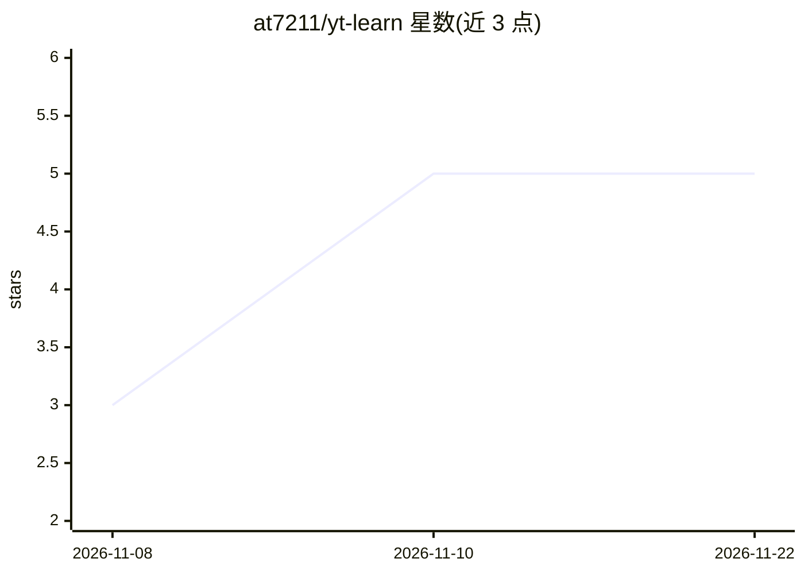

# at7211/yt-learn

⭐ 5 · JavaScript · MIT · 推送 2026-11-10 · [GitHub](https://github.com/at7211/yt-learn) · 个人维护 · 中文 README

**把 YouTube 影片生成本地英文課：雙字幕＋單字＋複習卡**

由 Chrome 擴充與本機 Python server（127.0.0.1:8765）組成的個人學習工具：抓取 YouTube 自帶時間戳字幕後，本機 pipeline 切句、翻成繁體中文、挑選單字片語並生成前情提要卡，疊層顯示在 YouTube 播放器上，也支援 Udemy、Netflix、HelloInterview。語言模型呼叫走已登入的 claude/codex CLI 或自備 Anthropic/OpenAI key；API 來源提供每課費用估算與每月上限。僅限本機個人使用，無字幕軌的影片無法處理。

## 筛选速览

| 维度 | 判定 | 备注 |
|---|---|---|
| AI 角色 | `ai-native` | 本体是模型或模型工具 |
| 许可风险 | `permissive` | MIT |
| 部署形态 | `None` |  |
| 模型依赖 | locked-api |  |
| 硬件要求 | — | 无带数字的原话,不猜 |
| 安装摩擦 | `low` | 无编译、无系统依赖或容器化 |
| 成熟度 | — | 结构信号不足 |

## 能力要点

- 字幕擷取→切句翻譯→挑字→前情提要的本機產課 pipeline，切句可 1–8 併行
- 四種語言模型來源：Claude CLI（預設）、Codex CLI、Anthropic key、OpenAI key
- API 來源顯示單課費用估算、usage 帳本與每月美元上限（80%/100% 提醒）
- 點字幕查劍橋英漢字典、選詞「問 AI」生成筆記、快捷鍵逐句操作

## 适用场景

- 跟 YouTube 演講學英文，邊看邊記單字
- 給已購買的 Udemy 講座疊加中英雙字幕與單字面板
- 用訂閱額度（CLI）控制成本的影片精讀

## 场景标签

`文档解析` · 领域:知识与检索

## 证据(README 行号)

> L3: **yt-learn** turns a YouTube video into an English lesson: bilingual EN/繁中 subtitles, a key-vocabulary panel and a r
> L20: 2. **產生課程**：本機 pipeline 切句、翻成繁體中文、挑出值得記的單字片語、寫一張背景卡。語言模型可以透過你已登入的 CLI 呼叫（預設 Claude，也可用 Codex，不需要 API key），也可以改用你自己的
> L11: 把一支 YouTube 影片變成一堂英文課：中英雙字幕、右側「本集精選單字」面板、開場「前情提要」卡、片尾總複習格。全部在本機跑，給自己學英文用。同一套疊層也能蓋在 Udemy 講座、Netflix 影集與 HelloInterv

## 星数曲线

2026-11-08 3 → 2026-11-22 5（+2）

---
*卡片 v1 · prompt 1.4 · 生成 2026-11-21 · 置信度 high · 依据 README sha `f009237d5375` · [字段定义](../../DATASET.md)*
