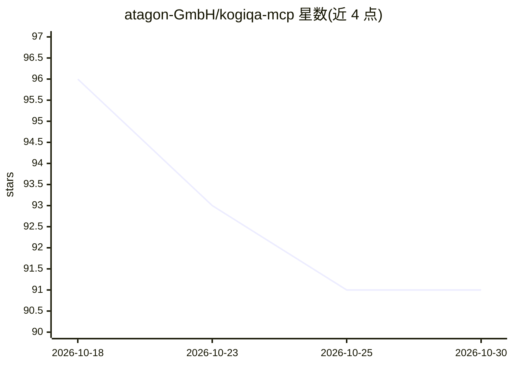

# atagon-GmbH/kogiqa-mcp

⭐ 91 · JavaScript · MIT · 推送 2026-10-23 · [GitHub](https://github.com/atagon-GmbH/kogiqa-mcp) · [官网](https://www.npmjs.com/package/kogiqa-mcp) · 组织维护

**供 LLM agent 使用的无选择器浏览器自动化 MCP 服务器**

基于 kogiQA 浏览器控制算法实现的 MCP（Model Context Protocol）服务器，向 LLM/agent 提供自然语言驱动的浏览器自动化能力，无需截图或视觉模型，且不依赖选择器即可与页面交互。定位用途包括调试样式问题、自动修复控制台错误、映射并文档化 Web 应用功能、编写端到端测试与探索性测试。通过 npx 安装，支持 Claude Code、VS Code、Cursor 及其他 MCP 客户端接入；要求 Node.js 20 或更新版本。README 中将其与 Playwright MCP 做机制对比（无选择器交互）。

## 筛选速览

| 维度 | 判定 | 备注 |
|---|---|---|
| AI 角色 | `ai-ecosystem` | LLM/agent 周边工具 |
| 许可风险 | `permissive` | MIT |
| 部署形态 | `library` | 以包/库形式分发 |
| 模型依赖 | — | README 未给出锁定关系 |
| 硬件要求 | — | 无带数字的原话,不猜 |
| 安装摩擦 | `low` | 无编译、无系统依赖或容器化 |
| 成熟度 | — | 结构信号不足 |

## 能力要点

- 自然语言驱动的浏览器自动化，无需截图或视觉模型
- 无选择器（selector-free）页面交互
- 支持 Claude Code / VS Code / Cursor 等多种 MCP 客户端接入
- 覆盖调试、控制台错误修复、E2E 测试生成与探索性测试场景

## 适用场景

- 让 agent 自动排查页面样式溢出等 UI 问题
- 自动收集并修复前端控制台错误
- 遍历应用页面生成功能文档或端到端测试

## 场景标签

`浏览器自动化` `代码生成` · 领域:效率与自动化

## 证据(README 行号)

> L7: A Model Context Protocol (MCP) server that provides browser automation capabilities using kogiQA. This server
> L22: The kogiQA MCP Server provides a browser which incorporates the capabilities of the kogiQA browser control algorith

## 星数曲线

2026-10-18 96 → 2026-10-30 91（-5）

---
*卡片 v1 · prompt 1.4 · 生成 2026-10-23 · 置信度 high · 依据 README sha `c177dc79407d` · [字段定义](../../DATASET.md)*
