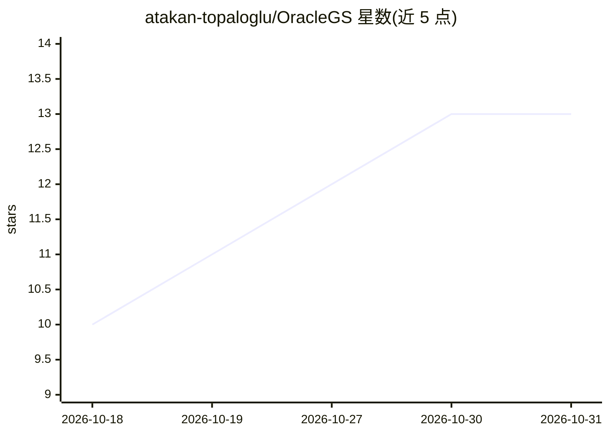

# atakan-topaloglu/OracleGS

⭐ 13 · Python · NOASSERTION · 推送 2026-02-16 · [GitHub](https://github.com/atakan-topaloglu/OracleGS) · [官网](https://atakan-topaloglu.github.io/oracle_gs/) · 个人维护

**稀疏视角 3D 高斯泼溅的论文参考实现（WACV'26 Oral）**

论文 OracleGS 的官方参考实现，基于 3DGS-MCMC 与原始 3DGS 代码库构建，面向稀疏视角输入下的高斯泼溅重建。流程分三步：用 Stable Virtual Camera 生成合成视图，用 VGGT 全局注意力图代理逐 patch 不确定性，再运行带尺度/不透明度正则与渐进增强策略的训练。安装需 conda 环境、PyTorch cu117 与 CUDA 子模块编译，主要供研究人员复现论文结果使用。

## 筛选速览

| 维度 | 判定 | 备注 |
|---|---|---|
| AI 角色 | `ai-native` | 本体是模型或模型工具 |
| 许可风险 | `none` | NOASSERTION |
| 部署形态 | `library` | 以包/库形式分发 |
| 模型依赖 | — | README 未给出锁定关系 |
| 硬件要求 | — | 无带数字的原话,不猜 |
| 安装摩擦 | `medium` | 含编译或系统依赖之一 |
| 成熟度 | — | 结构信号不足 |

## 能力要点

- Stable Virtual Camera 生成合成视图（CFG=3.0 等给定参数）
- VGGT 全局注意力图代理 per-patch 不确定性
- 在 3DGS-MCMC 基础上加入尺度/不透明度正则与渐进增强策略
- 提供复现论文结果的示例训练命令

## 适用场景

- 复现 WACV'26 论文的稀疏视角 3DGS 实验
- 在 Mip-NeRF360 等数据集上做稀疏视角新视角合成研究
- 基于生成先验与不确定性引导扩展高斯泼溅方法

## 场景标签

`科研工具` · 领域:学习与行业

## 证据(README 行号)

> L1: OracleGS: Grounding Generative Priors for Sparse-View Gaussian Splatting (WACV'26 Oral🎉)
> L37:  Use Stable Virtual Camera to generate images. Throughout the experiments, we used `CFG=3.0`, `T=80`, `L_short=80`.
> L46:  Use VGGT Global Attention Maps to proxy per-patch uncertainty using VGGT_aten. \

## 星数曲线

2026-10-18 10 → 2026-10-31 13（+3）

---
*卡片 v1 · prompt 1.4 · 生成 2026-10-31 · 置信度 mid · 依据 README sha `cb82c3094ba8` · [字段定义](../../DATASET.md)*
