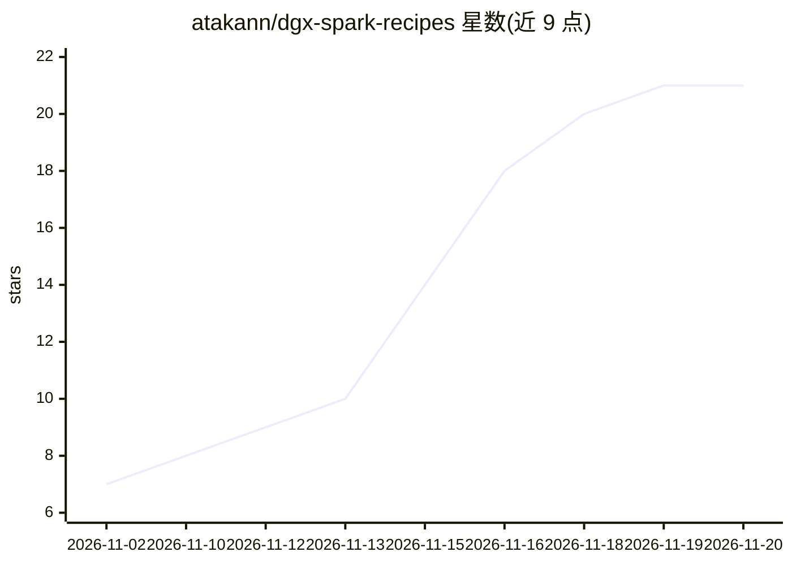

# atakann/dgx-spark-recipes

⭐ 21 · Python · MIT · 推送 2026-11-18 · [GitHub](https://github.com/atakann/dgx-spark-recipes) · 个人维护

**NVIDIA DGX Spark 实测运行配方集：LLM/图像/视频/语音/视觉任务**

面向 NVIDIA DGX Spark（GB10，128 GB 统一内存）的可执行配方集合，覆盖单机与双机（QSFP 互联）场景下的 LLM 服务、文生图、文生视频、语音合成/转写与视频检测跟踪。每个配方锁定容器镜像、引擎版本与模型 revision，附实测吞吐或耗时数据，并要求无宿主机改动（只读模型缓存、无附加权限）。需 Docker 与 NVIDIA runtime，--setup 构建镜像并下载模型；声明与 NVIDIA 及模型厂商无隶属关系。

## 筛选速览

| 维度 | 判定 | 备注 |
|---|---|---|
| AI 角色 | `ai-native` | 本体是模型或模型工具 |
| 许可风险 | `permissive` | MIT |
| 部署形态 | `self-host` | docker 或自建部署 |
| 模型依赖 | local-ok | 支持本地模型 |
| 硬件要求 | — | 无带数字的原话,不猜 |
| 安装摩擦 | `low` | 无编译、无系统依赖或容器化 |
| 成熟度 | — | 结构信号不足 |

## 能力要点

- 每个配方锁定容器镜像、引擎版本与模型 revision，并附实测数据
- 支持单台与双台 Spark（ssh 启动 worker、TP=2 张量并行）
- 覆盖 LLM 服务（vLLM/SGLang/llama.cpp/TensorFold 等）、图像、视频、语音与视频检测五类任务
- 运行无需宿主机改动：只读模型缓存、无附加权限、输出至 ./out

## 适用场景

- 在 DGX Spark 上按已测配置一键起本地 LLM 推理服务
- 双 Spark 互联下跑张量并行的 100B+ 模型
- 查阅各模型在 GB10 上的实测速度与显存占用数据选型
- 在 Spark 上运行文生图、文生视频、语音转写与视频检测任务

## 场景标签

`推理引擎` `图像生成` `视频生成` `语音合成` · 领域:内容生成

## 证据(README 行号)

> L5: Recipes for the NVIDIA DGX Spark (GB10, 128 GB unified memory), on one Spark or two: LLM serving, image,
> L6: video and speech, and vision (detection and tracking on video). Each one was run and measured on Sparks.
> L20: ./run-recipe.sh image/qwen-image-2.1-turbo --setup

## 星数曲线

2026-11-02 7 → 2026-11-20 21（+14）

---
*卡片 v1 · prompt 1.4 · 生成 2026-11-18 · 置信度 mid · 依据 README sha `e90d0b031e7a` · [字段定义](../../DATASET.md)*
