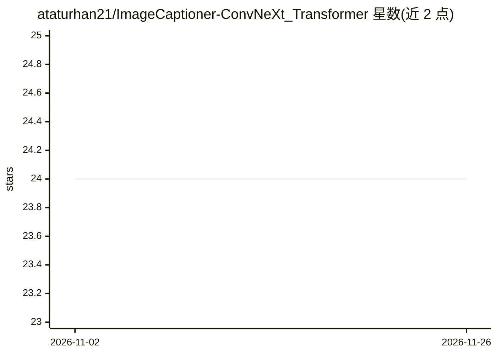

# ataturhan21/ImageCaptioner-ConvNeXt_Transformer

⭐ 24 · Jupyter Notebook · 推送 2026-11-14 · [GitHub](https://github.com/ataturhan21/ImageCaptioner-ConvNeXt_Transformer) · 个人维护

**ConvNeXt+Transformer 图像描述生成研究 notebook（Flickr8k）**

PyTorch 研究 notebook：用 ImageNet 预训练的 ConvNeXt Small 作图像编码器（去除分类头），自定义 Transformer 解码器配合 GPT-2 分词器，在 Flickr8k 上以 teacher forcing 训练，贪心解码生成图像描述。含超参数实验（解码器层数/ dropout）、checkpoint 保存、TensorBoard 日志与 5 张测试图的预测示例。设计在 Kaggle（T4 GPU）上运行，也可本地 Jupyter 运行，CUDA 可用时选用否则用 CPU；数据集与训练权重不含在仓库内，ROUGE-L 评估需重跑。仓库无开源许可，禁止复制、修改或再分发。

## 筛选速览

| 维度 | 判定 | 备注 |
|---|---|---|
| AI 角色 | `ai-native` | 本体是模型或模型工具 |
| 许可风险 | `none` | — |
| 部署形态 | `library` | 以包/库形式分发 |
| 模型依赖 | — | README 未给出锁定关系 |
| 硬件要求 | — | 无带数字的原话,不猜 |
| 安装摩擦 | `medium` | 含编译或系统依赖之一 |
| 成熟度 | — | 结构信号不足 |

## 能力要点

- ConvNeXt Small 编码器 + 自定义 Transformer 解码器 + GPT-2 分词器
- 解码器层数与 dropout 网格超参数实验及保存结果
- GPU 训练的 checkpoint 可加载到仅 CPU 机器
- 含无需下载数据的轻量单元回归检查与 GitHub Actions 工作流

## 适用场景

- 学习编码器-解码器结构的图像描述训练流程
- 在 Kaggle 上复现 Flickr8k 描述生成实验
- 参考 Transformer 解码器的掩码与评估实现细节

## 场景标签

`多模态` `教程课程` · 领域:学习与行业

## 证据(README 行号)

> L3: A PyTorch research notebook that generates image captions with a pretrained ConvNeXt Small image encoder and a custo
> L21: GPT-2 supplies the tokenizer only. The notebook trains its own caption decoder rather than loading a pretrained GPT

## 星数曲线

2026-11-02 24 → 2026-11-26 24（+0）

---
*卡片 v1 · prompt 1.4 · 生成 2026-11-18 · 置信度 high · 依据 README sha `53516e8b05cc` · [字段定义](../../DATASET.md)*
