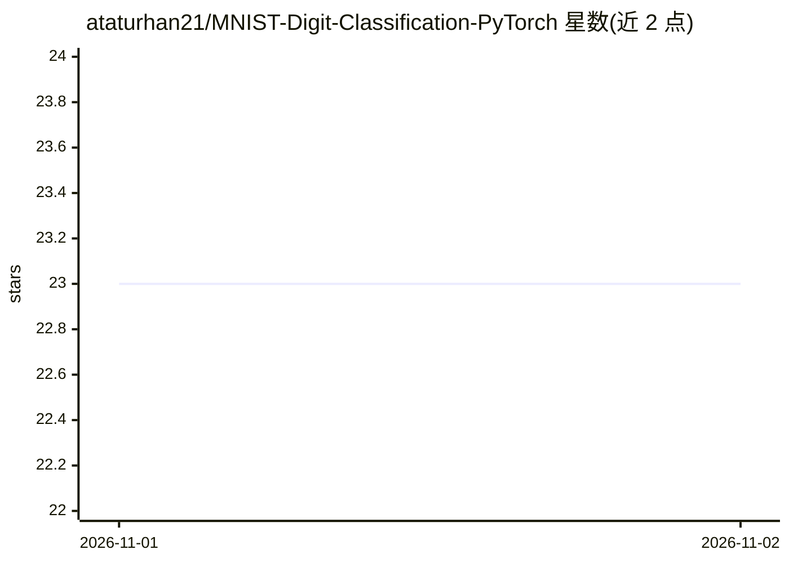

# ataturhan21/MNIST-Digit-Classification-PyTorch

⭐ 23 · Jupyter Notebook · MIT · 推送 2026-10-31 · [GitHub](https://github.com/ataturhan21/MNIST-Digit-Classification-PyTorch) · 个人维护

**PyTorch 全连接网络完成 MNIST 手写数字分类的 notebook**

面向 Kaggle Digit Recognizer 比赛的 Jupyter notebook：读取带标签与无标签的像素 CSV，训练 784→128→64→10 的全连接分类器（ReLU、交叉熵、Adam、批 64、默认 10 epochs），导出含 ImageId 与 Label 列的 submission.csv。提供 Kaggle 与本地两种运行路径；代码在 CPU 上运行，不移到 GPU。数据集与训练权重不含在仓库内，依赖列表未固定版本。附指标算术的单元测试与 GitHub Actions 检查。

## 筛选速览

| 维度 | 判定 | 备注 |
|---|---|---|
| AI 角色 | `ai-native` | 本体是模型或模型工具 |
| 许可风险 | `permissive` | MIT |
| 部署形态 | `library` | 以包/库形式分发 |
| 模型依赖 | — | README 未给出锁定关系 |
| 硬件要求 | — | 无带数字的原话,不猜 |
| 安装摩擦 | `low` | 无编译、无系统依赖或容器化 |
| 成熟度 | — | 结构信号不足 |

## 能力要点

- 784→128→64→10 全连接网络训练与 submission.csv 导出
- 固定种子与 80/20 验证划分（random_state=42）
- 损失/准确率计算的单元测试与 CI 检查（不做训练）

## 适用场景

- 参加 Kaggle Digit Recognizer 比赛并生成提交文件
- 学习 PyTorch 全连接网络的基础训练流程
- 了解带验证与测试的 notebook 工程结构

## 场景标签

`目标检测` `教程课程` · 领域:学习与行业

## 证据(README 行号)

> L3: A notebook for Kaggle's Digit Recognizer competition. It reads labeled and unlabeled pixel CSV files, trains a fully
> L11: - Train a 784 → 128 → 64 → 10 network with ReLU activations, cross-entropy loss, and Adam at a learning rate of 0.0

## 星数曲线

2026-11-01 23 → 2026-11-02 23（+0）

---
*卡片 v1 · prompt 1.4 · 生成 2026-10-31 · 置信度 mid · 依据 README sha `62f8eaa85d7c` · [字段定义](../../DATASET.md)*
