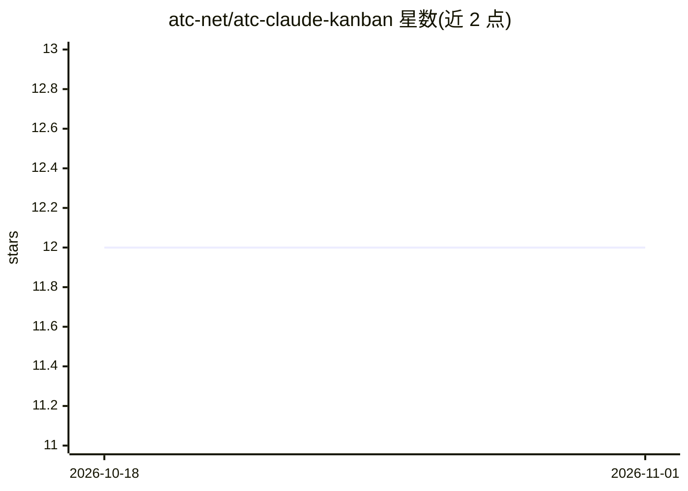

# atc-net/atc-claude-kanban

⭐ 12 · C# · MIT · 推送 2026-10-28 · [GitHub](https://github.com/atc-net/atc-claude-kanban) · 组织维护

**浏览器看板实时监控 Claude Code 任务、会话与子代理**

面向 Claude Code 用户的 .NET 全局工具：读取 ~/.claude/ 下的任务文件与 JSONL 会话转录，在浏览器看板实时展示任务流（Pending→In Progress→Completed）、时间线、子代理与 Agent 团队状态、每会话 token/成本统计、上下文窗口占用、消息日志、工具统计与工作流查看器；通过文件监听加 Server-Sent Events 实现免轮询即时更新。需 .NET 10 SDK 与启用任务工具的 Claude Code；脚本永不执行。以 dotnet tool 安装，默认端口 3541。

## 筛选速览

| 维度 | 判定 | 备注 |
|---|---|---|
| AI 角色 | `ai-ecosystem` | LLM/agent 周边工具 |
| 许可风险 | `permissive` | MIT |
| 部署形态 | `None` |  |
| 模型依赖 | — | README 未给出锁定关系 |
| 硬件要求 | — | 无带数字的原话,不猜 |
| 安装摩擦 | `medium` | 含编译或系统依赖之一 |
| 成熟度 | — | 结构信号不足 |

## 能力要点

- 看板/时间线实时呈现 Claude Code 任务与依赖关系
- 按会话的 token/成本追踪与上下文窗口用量条
- 子代理、Agent 团队与 Workflow 查看器（journal 派生状态）
- 文件监听 + SSE 免轮询实时更新，桌面通知与声音提示

## 适用场景

- 同时跑多个 Claude Code 会话时跟踪任务进度
- 查看各会话和子代理的 token 消耗与成本
- 回顾会话完整消息日志、工具调用与工作流执行情况

## 场景标签

`LLM 可观测性` · 领域:评测与运维

## 证据(README 行号)

> L3: Real-time Kanban dashboard for monitoring Claude Code agent tasks, sessions, and subagents through a browser-based b
> L61: The Kanban board reads the task files Claude Code writes under `~/.claude/tasks/`. Those files only exist while the
> L186: - Parsed from JSONL transcript files at `~/.claude/projects/{hash}/{sessionId}/subagents/`

## 星数曲线

2026-10-18 12 → 2026-11-01 12（+0）

---
*卡片 v1 · prompt 1.4 · 生成 2026-11-01 · 置信度 high · 依据 README sha `627475ddf235` · [字段定义](../../DATASET.md)*
