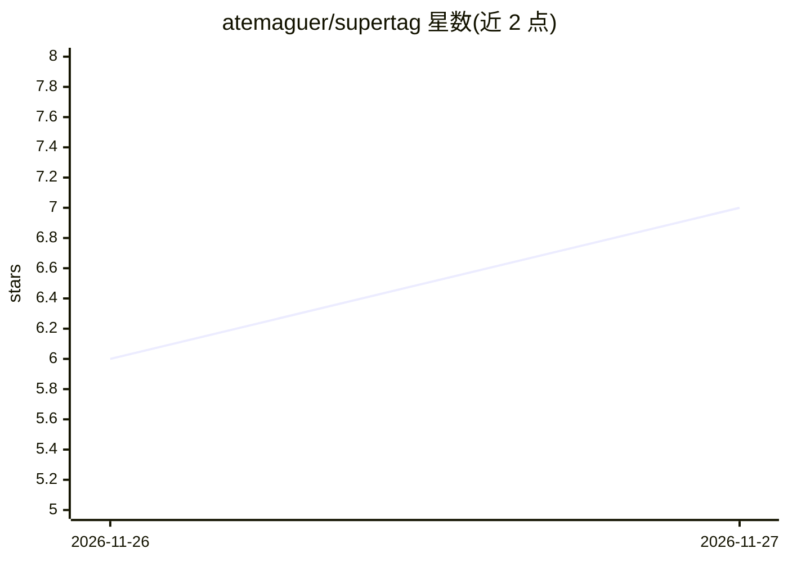

# atemaguer/supertag

⭐ 7 · Rust · Apache-2.0 · 推送 2026-11-26 · [GitHub](https://github.com/atemaguer/supertag) · 个人维护 · 中文 README

**自托管基础设施：让 AI 代理持有持续职责并主动工作**

SuperTag 是开源的自托管基础设施，将 AI 代理称为 Tag：每个 Tag 拥有独立身份、权限、职责与工作历史，可在会话之间持久存在。Tag 持有的是职责（job）而非单次任务，能响应 Sentry/PagerDuty/CI 等事件主动行动，并通过 Control Plane 与团队成员及其他 Tag 协作。工作由 Claude Code、Codex、Cursor、OpenCode 等编码代理分片执行；提供 supertag init/message/goal 等 CLI 命令，支持以 org-chart 式配置构建多角色组织。

## 筛选速览

| 维度 | 判定 | 备注 |
|---|---|---|
| AI 角色 | `ai-ecosystem` | LLM/agent 周边工具 |
| 许可风险 | `permissive` | Apache-2.0 |
| 部署形态 | `library` | 以包/库形式分发 |
| 模型依赖 | — | README 未给出锁定关系 |
| 硬件要求 | — | 无带数字的原话,不猜 |
| 安装摩擦 | `low` | 无编译、无系统依赖或容器化 |
| 成熟度 | — | 结构信号不足 |

## 能力要点

- Tag 在会话间持久存在，可跨机器与编码代理延续工作
- 响应 CI 失败、告警、Sentry 事件等主动开始工作
- 自托管共享 Control Plane，团队成员与 Tag 多人协作
- org-chart 式配置 Role/Team/权限，记录审批与决策

## 适用场景

- 让可靠性 Tag 自动分派生产报错并准备修复分支
- 给 lead Tag 一个目标，由它拆分给多个团队协作完成
- 为营销、销售等职能搭建同类代理组织

## 场景标签

`Agent 记忆` `多智能体` `Agent 框架` · 领域:Agent 开发

## 证据(README 行号)

> L17: SuperTag is open infrastructure for always-on AI agents. SuperTag calls each one a **Tag**: a
> L20: with your team and with other Tags. You give a Tag a job, and Claude Code, Codex, Cursor, or
> L122: Jobs on a team overlap. Self-host one shared Control Plane, and your team works with Tags

## 星数曲线

2026-11-26 6 → 2026-11-27 7（+1）

---
*卡片 v1 · prompt 1.4 · 生成 2026-11-26 · 置信度 mid · 依据 README sha `ef91d4e0428f` · [字段定义](../../DATASET.md)*
