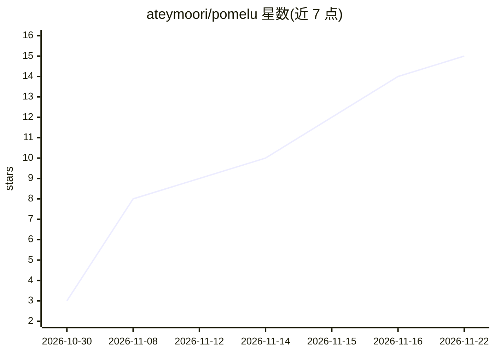

# ateymoori/pomelu

⭐ 15 · Dart · Apache-2.0 · 推送 2026-11-21 · [GitHub](https://github.com/ateymoori/pomelu) · [官网](https://royan.se/pomelu/) · 组织维护

**自托管 Hermes Agent 的开源移动聊天客户端**

由 Royan AB 开发的 Flutter 应用（Android/iOS），作为自托管 Hermes Agent（Nous Research）的纯客户端：通过 JSON-RPC over WebSocket 连接 Hermes gateway，把每个 bot 呈现为聊天会话，支持语音、图片、视频、文件双向传递、命令审批、Bot Screen（Linux 桌面观看/接管）与定时任务管理。本体不含 agent 逻辑，模型支持取决于用户的 Hermes 配置。需先运行 Hermes Agent 0.21.5+；提供应用商店与 GitHub APK 分发，也可用 Flutter 从源码构建。

## 筛选速览

| 维度 | 判定 | 备注 |
|---|---|---|
| AI 角色 | `ai-ecosystem` | LLM/agent 周边工具 |
| 许可风险 | `permissive` | Apache-2.0 |
| 部署形态 | `desktop` | 安装包/桌面程序 |
| 模型依赖 | — | README 未给出锁定关系 |
| 硬件要求 | — | 无带数字的原话,不猜 |
| 安装摩擦 | `low` | 无编译、无系统依赖或容器化 |
| 成熟度 | — | 结构信号不足 |

## 能力要点

- 纯客户端架构：JSON-RPC over WebSocket 连接 Hermes gateway
- 语音/图片/视频/文件双向传递与命令一键审批
- Bot Screen：实时观看并在 Linux 桌面接管 bot 操作
- 无账号、无追踪；推送经中继且端到端密封

## 适用场景

- 在手机/平板上与我自托管的 Hermes Agent bots 对话
- 外出时经 Tailscale 等私有网络连接家里运行的 agent
- 审批 agent 的命令提问并接收推送通知

## 场景标签

`AI 助手` `聊天机器人` · 领域:对话与助手

## 证据(README 行号)

> L5: **Open-source mobile client for Hermes Agent by Nous Research.**
> L181: Pomelu is a pure client. It speaks JSON-RPC over WebSocket to the Hermes
> L183: cron jobs. It has no agent logic of its own.

## 星数曲线

2026-10-30 3 → 2026-11-22 15（+12）

---
*卡片 v1 · prompt 1.4 · 生成 2026-11-18 · 置信度 high · 依据 README sha `1f685252cfee` · [字段定义](../../DATASET.md)*
