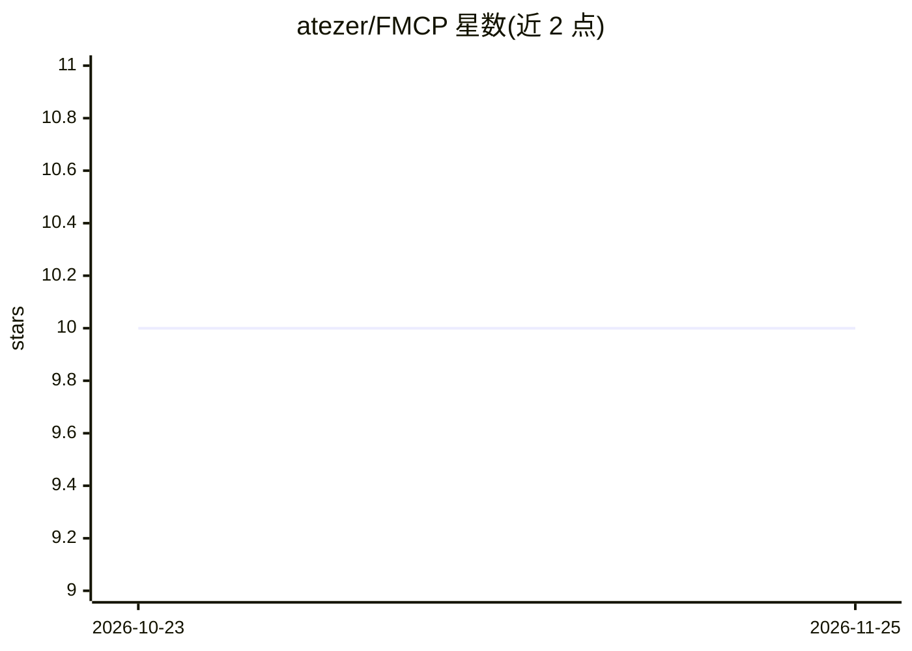

# atezer/FMCP

⭐ 10 · TypeScript · MIT · 推送 2026-10-15 · [GitHub](https://github.com/atezer/FMCP) · [官网](https://www.npmjs.com/package/@atezer/figma-mcp-bridge) · 个人维护

**把 Figma 设计接入 Claude/Cursor 的 MCP 桥接插件**

F-MCP 是连接 Figma 与本地 AI 客户端的 MCP 桥：通过 Figma 插件与 localhost（5454–5470）上的 bridge 通信，提供 63 个工具、29 个 skill、3 个编排器，支持读取设计/提取 token、生成与修改 frame、导出 SVG、原型连线与动画、DS 合规审计与变更追踪。要求 Claude 与 Figma 在同一台机器上运行；云上 Claude 会话无法访问 bridge。数据留在本地，Figma API token 可选启用评论/版本历史等附加功能。

## 筛选速览

| 维度 | 判定 | 备注 |
|---|---|---|
| AI 角色 | `ai-ecosystem` | LLM/agent 周边工具 |
| 许可风险 | `permissive` | MIT |
| 部署形态 | `None` |  |
| 模型依赖 | — | README 未给出锁定关系 |
| 硬件要求 | — | 无带数字的原话,不猜 |
| 安装摩擦 | `low` | 无编译、无系统依赖或容器化 |
| 成熟度 | — | 结构信号不足 |

## 能力要点

- 63 工具覆盖设计读取、生成、token 管理与原型自动化
- 零配置设计系统自动发现（DS-agnostic，本地 registry）
- 数据仅在本机 localhost 通信，可离线使用
- 支持 Claude Desktop/Code 与 Cursor 四种运行环境

## 适用场景

- 让 AI 读取 Figma 设计并提取设计 token
- 用对话生成/修改 Figma 界面并搭建原型动线
- 对自有设计系统做合规审计与变更追踪
- 从选中的组件生成 React 代码

## 场景标签

`代码生成` · 领域:编码与开发

## 证据(README 行号)

> L15: Figma tasarımlarınızı AI'a bağlar. AI'a *"Bu ekrandaki renkleri çıkar"* veya *"Yeni bir login sayfası oluştur"* der
> L190: - **Ne yapar** — Claude veya Cursor'dan Figma'ya ekran tasarlar, tasarım sistemini denetler, renk/yazı/boşluk toke
> L192: - **Nasıl çalışır** — Her görev için kendi **skill**'i var (kural seti + örnek). Claude Code'da **agent + sub-agen

## 星数曲线

2026-10-23 10 → 2026-11-25 10（+0）

---
*卡片 v1 · prompt 1.4 · 生成 2026-11-20 · 置信度 high · 依据 README sha `bf5155b4605f` · [字段定义](../../DATASET.md)*
