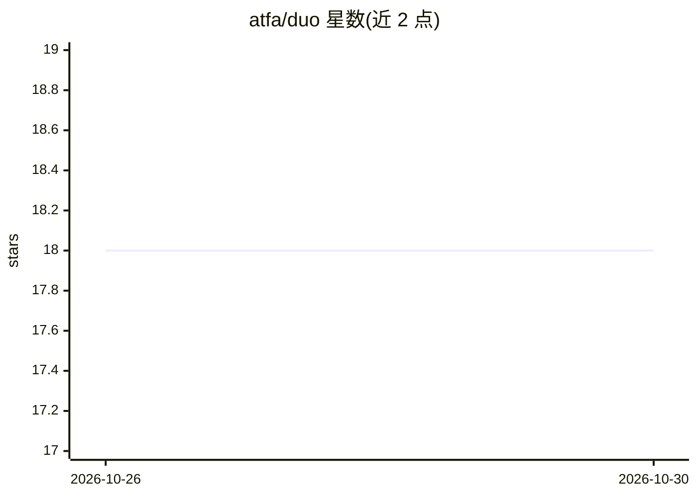

# atfa/duo

⭐ 18 · Go · MIT · 推送 2026-10-29 · [GitHub](https://github.com/atfa/duo) · [官网](https://xduo.dev/) · 个人维护

**协调两个编码 agent 在隔离 Git worktree 中协作与交叉审查的 CLI 工具**

Duo 在同一仓库的两个独立 Git worktree 中运行两个编码 agent（Austin 实现者与 Tony 验证者），提供 Fast/Goal/Step 三种工作流，负责计划共享、交叉审查、验证门禁、Git 证据与安全交付。内置 pi、agy、opencode、codex 四种 agent 驱动，支持插件发现。提供 gotui 仪表盘、手机二维码远程控制（中继仅存密文）、xduo 多实例管理（Linux + tmux）、浏览器终端与 Cloudflare Tunnel。用 Go 编写，跨平台发布二进制。

## 筛选速览

| 维度 | 判定 | 备注 |
|---|---|---|
| AI 角色 | `ai-ecosystem` | LLM/agent 周边工具 |
| 许可风险 | `permissive` | MIT |
| 部署形态 | `desktop` | 安装包/桌面程序 |
| 模型依赖 | — | README 未给出锁定关系 |
| 硬件要求 | — | 无带数字的原话,不猜 |
| 安装摩擦 | `low` | 无编译、无系统依赖或容器化 |
| 成熟度 | — | 结构信号不足 |

## 能力要点

- Fast/Goal/Step 三种双 agent 协作工作流，含交叉审查与签核
- agent 各自运行于隔离 Git worktree，成果交付回起始分支
- 内置 pi/agy/opencode/codex 四种驱动，另支持插件发现
- xduo 管理多实例：tmux 会话、浏览器终端、Cloudflare Tunnel

## 适用场景

- 让两个编码 agent 独立实现并互相审查同一次提交
- 通过手机扫码远程跟进任务、切换模式或模型
- 在多台机器/多项目上并行运行多个 Duo 实例

## 场景标签

`多智能体` `编码 Agent` · 领域:Agent 开发

## 证据(README 行号)

> L3: **Two peer coding agents, coordinated in isolated Git worktrees and delivered back to your repository.**
> L11: Duo owns coordination, verification gates, Git evidence, and safe delivery. Agents work in separate Git worktrees; 
> L133: Built-in drivers are `pi`, `agy`, `opencode`, and `codex`. Choose one for both agents with `--agent`, or choose ea

## 星数曲线

2026-10-26 18 → 2026-10-30 18（+0）

---
*卡片 v1 · prompt 1.4 · 生成 2026-10-30 · 置信度 high · 依据 README sha `9a21db9b0d44` · [字段定义](../../DATASET.md)*
