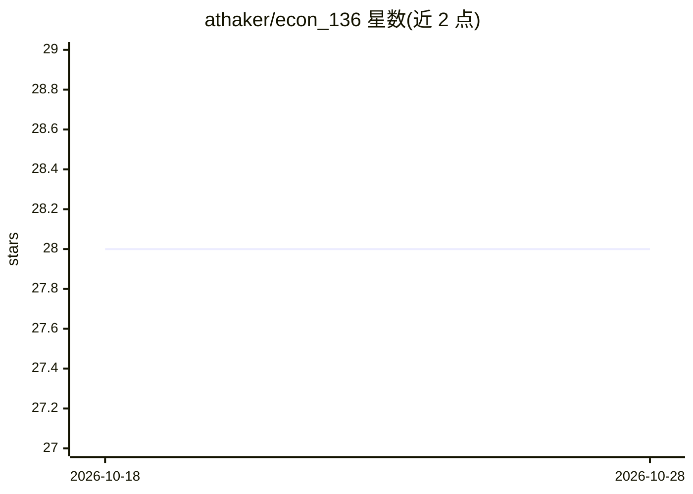

# athaker/econ_136

⭐ 28 · Jupyter Notebook · 推送 2026-08-12 · [GitHub](https://github.com/athaker/econ_136) · 个人维护

**Kalshi 事件合约做市 Agent 的教学演示代码（会议演讲配套）**

Ai4 2026 演讲配套代码：用一个微型 Q-network 将市场状态（最优买卖价、盘口深度、库存）映射为 HOLD/BID/ASK 三种动作，在 Kalshi 预测市场挂被动限价单提供流动性，周期末强制平仓。README 明确声明仅用于教学：网络随机初始化、不训练，决策实质随机，非交易系统。附带盘口文本渲染查看器 book_viewer.py 与 --scan 市场扫描（按净边际与成交概率排序），支持模拟环境和 DRY_RUN。面向量化金融学习者与演讲听众。

## 筛选速览

| 维度 | 判定 | 备注 |
|---|---|---|
| AI 角色 | `ai-native` | 本体是模型或模型工具 |
| 许可风险 | `none` | — |
| 部署形态 | `library` | 以包/库形式分发 |
| 模型依赖 | — | README 未给出锁定关系 |
| 硬件要求 | — | 无带数字的原话,不猜 |
| 安装摩擦 | `low` | 无编译、无系统依赖或容器化 |
| 成熟度 | — | 结构信号不足 |

## 能力要点

- 微型 Q-network 状态→动作结构演示（未训练，随机初始化）
- 文本深度阶梯盘口查看器，含自身挂单位置与 microprice
- --scan 按费用后边际（NET/1）与预期成交（FILL/S）排序市场
- 适配 2026 年 3 月后 Kalshi API（mils 整数价格运算封装）

## 适用场景

- 在演讲或课堂上演示做市 Agent 的状态-动作-奖励结构
- 用模拟环境或 DRY_RUN 排练做市流程，不下真实订单
- 扫描 Kalshi 市场并观察盘口深度与微观价格

## 场景标签

`金融量化` `教程课程` · 领域:学习与行业

## 证据(README 行号)

> L35: 1. A tiny Q-network maps market state (best YES bid/ask, book depth, inventory)
> L36:  to one of three actions: `HOLD`, `BID`, or `ASK`.

## 星数曲线

2026-10-18 28 → 2026-10-28 28（+0）

---
*卡片 v1 · prompt 1.4 · 生成 2026-10-26 · 置信度 mid · 依据 README sha `469f9ddc3767` · [字段定义](../../DATASET.md)*
