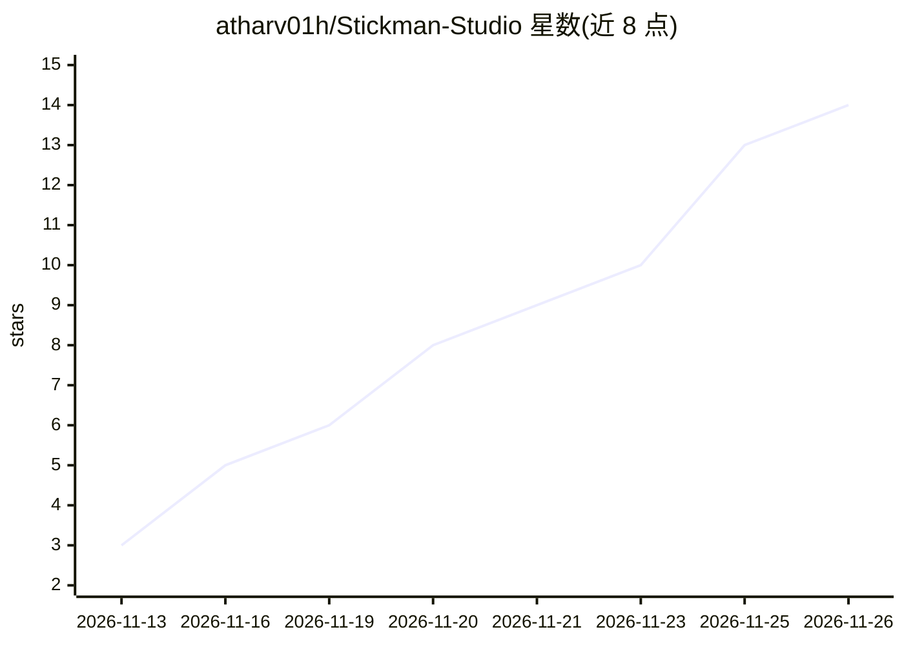

# atharv01h/Stickman-Studio

⭐ 14 · Python · MIT · 推送 2026-11-20 · [GitHub](https://github.com/atharv01h/Stickman-Studio) · [官网](https://stickmanstudio.netlify.app/) · 个人维护

**面向内容创作者的本地离线 AI 火柴人短视频生成器**

面向 Windows 的本地视频制作套件：输入主题或旁白脚本，离线生成带配音的火柴人/插画解说短视频（9:16 竖屏 Reel/Shorts）。内置 AI Director 在本地生成脚本与分镜（<15ms），TTS 使用本地 Kokoro-82M ONNX 或 SAPI，动画基于程序化向量引擎与 45 种编排，渲染走 CPU/FFmpeg 或 NVENC。零 API key、零订阅；仅支持 Windows 10/11 与 Python 3.10+。

## 筛选速览

| 维度 | 判定 | 备注 |
|---|---|---|
| AI 角色 | `ai-native` | 本体是模型或模型工具 |
| 许可风险 | `permissive` | MIT |
| 部署形态 | `library` | 以包/库形式分发 |
| 模型依赖 | local-ok | 支持本地模型 |
| 硬件要求 | `gpu-8g` | |
| 安装摩擦 | `medium` | 含编译或系统依赖之一 |
| 成熟度 | — | 结构信号不足 |

## 能力要点

- 内置 AI Director 离线生成脚本与分板（Solo 叙事与双人对话两种模式）
- 本地 Kokoro-82M ONNX / SAPI TTS 配音，音频视频帧级同步
- 1,000+ 程序化向量对象与 1,750+ 程序化背景，45 种场景编排
- 双动画模式：Moving Stickman 与 Cinematic Illustrated Reels

## 适用场景

- 从主题文本生成解说类竖屏短视频
- 无需云端服务离线制作带旁白的动画 Reel
- 为 faceless 频道批量产出脚本与成片

## 场景标签

`视频生成` `语音合成` `AI 写作` · 领域:内容生成

## 证据(README 行号)

> L19: > An autonomous, **100% local, free, offline AI video production suite** for Windows. Turn any topic or narration s
> L140: |🧠 **Autonomous Inbuilt AI Director**|100% offline neural intelligence generating viral scripts & storyboards inst

## 星数曲线

2026-11-13 3 → 2026-11-26 14（+11）

---
*卡片 v1 · prompt 1.4 · 生成 2026-11-20 · 置信度 mid · 依据 README sha `63545cc77f63` · [字段定义](../../DATASET.md)*
