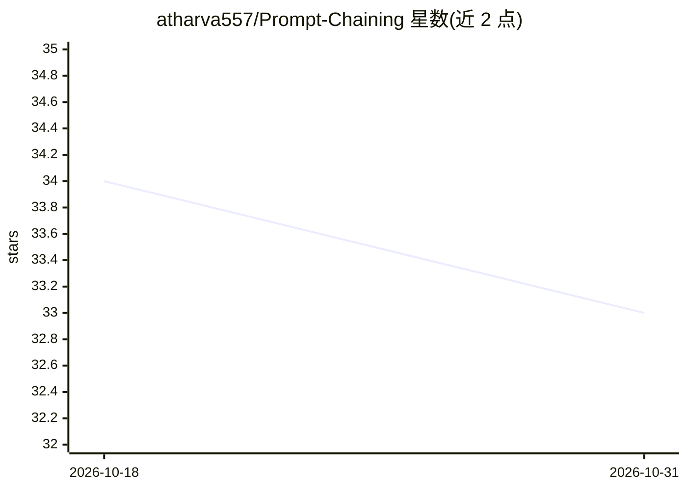

# atharva557/Prompt-Chaining

⭐ 33 · Python · MIT · 推送 2026-07-18 · [GitHub](https://github.com/atharva557/Prompt-Chaining) · [官网](https://pypi.org/project/promptchain/) · 个人维护

**本地模型生命周期管理库+MCP 服务器，及双模型提示链编码应用**

仓库包含两部分：`promptchain` 是 pip 安装的 Python 库兼 MCP 服务器，跨 LM Studio、Ollama 与任意 OpenAI 兼容端点管理本地模型的加载/卸载/固定/换组，带策略引擎（manual/auto、VRAM 预算、空闲卸载），可将 GPU 管控暴露给 Claude Code 等 agent；上层是 Streamlit 两模型应用：小模型起草提示词，经人工审核门修改后由大模型（本地或云端）生成代码，支持多文件输出、46 个预设、流式与运行历史。面向在家运行 LLM 的开发者，本地优先、云端可选、无遥测。

## 筛选速览

| 维度 | 判定 | 备注 |
|---|---|---|
| AI 角色 | `ai-ecosystem` | LLM/agent 周边工具 |
| 许可风险 | `permissive` | MIT |
| 部署形态 | `library` | 以包/库形式分发 |
| 模型依赖 | local-ok | 支持本地模型 |
| 硬件要求 | — | 无带数字的原话,不猜 |
| 安装摩擦 | `low` | 无编译、无系统依赖或容器化 |
| 成熟度 | — | 结构信号不足 |

## 能力要点

- 跨 LM Studio/Ollama/OpenAI 兼容端点的统一模型生命周期管理与策略引擎
- MCP 服务器让编码 agent 自行管理 GPU 占用（ps/unload_all/load_model）
- 两阶段流水线带人工审核门：小模型起草提示词，人工修改后再调用大模型生成代码
- 按角色混配本地与云后端，46 个内置系统提示预设

## 适用场景

- 在显存有限的 GPU 上自动换入换出两个本地模型
- 让 Claude Code 等 agent 通过 MCP 查看和释放本地显存
- 用小模型起草提示词、人工把关后由云端模型生成代码以减少重试

## 场景标签

`提示工程` `代码生成` · 领域:Agent 开发

## 证据(README 行号)

> L17: |📦|**`promptchain` — the library + MCP server.** Load, unload, swap, and pin any number of local models (LM Studio,
> L24: What `promptchain` adds is the combination none of them ship: **one client — and one MCP server — that spans LM Stu
> L5: A pip-installable library + MCP server for explicit local-model lifecycle control, and a two-model Streamlit app bui

## 星数曲线

2026-10-18 34 → 2026-10-31 33（-1）

---
*卡片 v1 · prompt 1.4 · 生成 2026-10-25 · 置信度 high · 依据 README sha `cad30d8bc1b4` · [字段定义](../../DATASET.md)*
