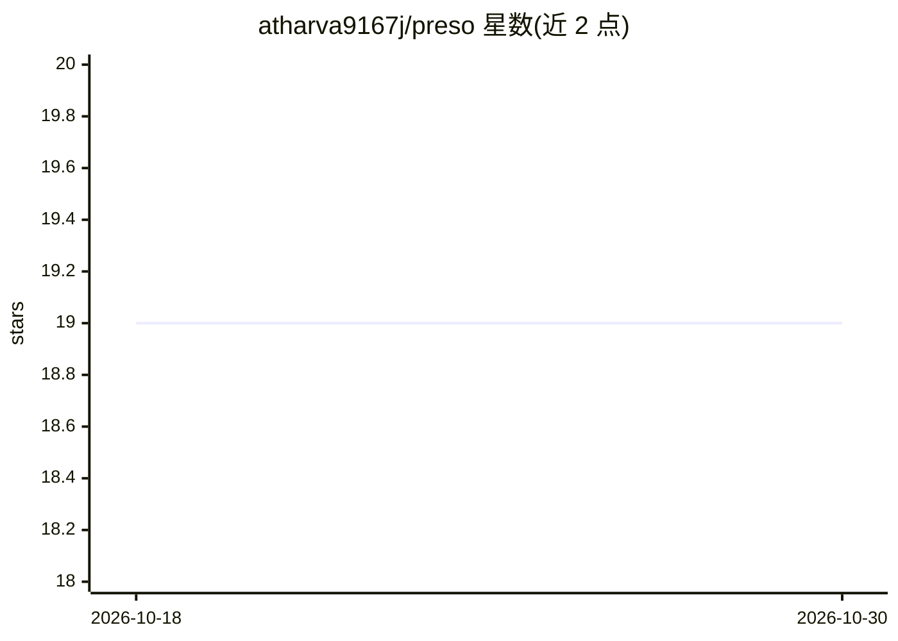

# atharva9167j/preso

⭐ 19 · TypeScript · MIT · 推送 2025-12-17 · [GitHub](https://github.com/atharva9167j/preso) · [官网](https://preso-ai.vercel.app/) · 个人维护

**AI 驱动的演示文稿生成平台：从提示/文本/文档生成幻灯片**

基于 React 18 + TypeScript 的 Web 演示文稿平台，提供 Prompt-to-Deck、Text-to-Deck、Doc-to-Deck（PDF/MD/Text）三种生成引擎，使用 Google Gemini Pro & Flash 生成内容，Pollinations AI 生成图像。内置 1920x1080 固定画布编辑器，支持拖拽、缩放、旋转与自然语言 AI Remix 修改。可导出交互 HTML、PDF、PPTX、PNG。数据存储于浏览器 IndexedDB，API 密钥本地保存。运行需 Node.js 18+ 与 Google AI Studio、Pollinations API 密钥（Pexels 密钥可选）。面向需要从提示或文档快速生成演示文稿的用户。

## 筛选速览

| 维度 | 判定 | 备注 |
|---|---|---|
| AI 角色 | `ai-native` | 本体是模型或模型工具 |
| 许可风险 | `permissive` | MIT |
| 部署形态 | `library` | 以包/库形式分发 |
| 模型依赖 | — | README 未给出锁定关系 |
| 硬件要求 | — | 无带数字的原话,不猜 |
| 安装摩擦 | `low` | 无编译、无系统依赖或容器化 |
| 成熟度 | — | 结构信号不足 |

## 能力要点

- 三种生成引擎：提示/文本/文档（PDF、MD、Text）转幻灯片
- 1920x1080 像素级编辑画布，支持自然语言 AI Remix
- 导出交互 HTML、PDF、PPTX、PNG 四种格式
- 浏览器 IndexedDB 本地存储，数据不上传服务器

## 适用场景

- 用一句话提示快速生成结构化演示文稿
- 把杂乱笔记或 PDF 文档整理成幻灯片
- 在浏览器内像素级编辑并用自然语言修改幻灯片

## 场景标签

`AI 写作` · 领域:内容生成

## 证据(README 行号)

> L3: Preso is a high-fidelity, AI-driven presentation platform that allows users to transform simple prompts, raw text, o
> L36: - **AI**: Google Gemini Pro & Flash (via `@google/generai`)

## 星数曲线

2026-10-18 19 → 2026-10-30 19（+0）

---
*卡片 v1 · prompt 1.4 · 生成 2026-10-28 · 置信度 high · 依据 README sha `fc4f6a1f9626` · [字段定义](../../DATASET.md)*
