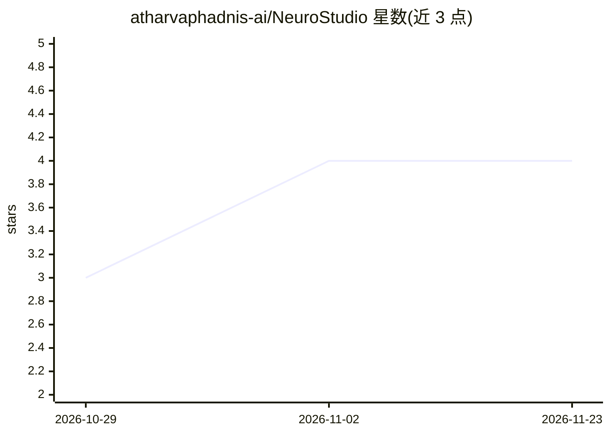

# atharvaphadnis-ai/NeuroStudio

⭐ 4 · Go · MIT · 推送 2026-10-28 · [GitHub](https://github.com/atharvaphadnis-ai/NeuroStudio) · 个人维护

**自托管本地训练工作台：数据、训练、评估、推理一体**

Go 编写的单二进制本地 AI 训练工作台：提供数据集上传与清洗（去重、损坏检测）、分层划分、纯 Go 实现的 CNN 图像分类训练（Adam/SGD、数据增强、早停、检查点）、SSE 实时训练面板、留出集评估（accuracy/macro-F1/混淆矩阵）、实验跟踪、带版本与校验和的模型注册表，以及 REST /predict 与浏览器 Playground 推理。数据不出本机，无遥测无账号。仅支持 CPU；面向笔记本规模数据集（数千张 16–96 px 小图）；目标检测/文本/ONNX 导出尚在规划中。

## 筛选速览

| 维度 | 判定 | 备注 |
|---|---|---|
| AI 角色 | `ai-native` | 本体是模型或模型工具 |
| 许可风险 | `permissive` | MIT |
| 部署形态 | `None` |  |
| 模型依赖 | — | README 未给出锁定关系 |
| 硬件要求 | `cpu-ok` | |
| 安装摩擦 | `low` | 无编译、无系统依赖或容器化 |
| 成熟度 | `idea` | |

## 能力要点

- 纯 Go 手写 CNN 训练引擎，梯度经单元测试校验
- SSE 实时训练面板：进度、loss 曲线、安全取消
- 评估输出 accuracy、macro-F1、混淆矩阵与延迟 p50/p95
- 模型注册表：版本化权重、SHA-256 校验和、下载

## 适用场景

- 在没有云账号和遥测的本地环境训练图像分类模型
- 在笔记本上用几百到几千张小图快速跑通训练到推理流程
- 记录每次实验的配置与指标以便复现对比
- 通过本地 REST API 为应用提供分类预测

## 场景标签

`模型训练` `MLOps` `推理引擎` · 领域:训练与推理

## 证据(README 行号)

> L5: **A self-hosted, local-first AI training studio.** Inspired by Google's Teachable Machine,
> L27: |**Real image-classification training** — pure-Go CNN, hand-written forward/backward, gradient-checked|✅|
> L33: |Inference: REST `POST /predict` + in-browser Playground with drag & drop|✅|

## 星数曲线

2026-10-29 3 → 2026-11-23 4（+1）

---
*卡片 v1 · prompt 1.4 · 生成 2026-11-21 · 置信度 high · 依据 README sha `b4ca25a18c1c` · [字段定义](../../DATASET.md)*
