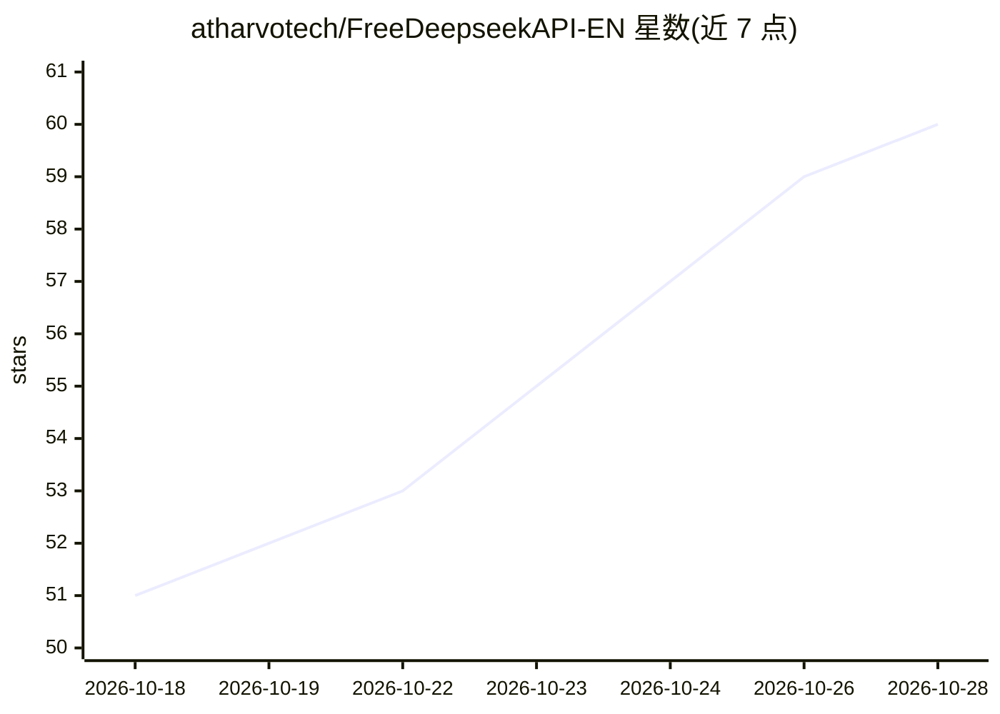

# atharvotech/FreeDeepseekAPI-EN

⭐ 61 · JavaScript · NOASSERTION · 推送 2026-09-06 · [GitHub](https://github.com/atharvotech/FreeDeepseekAPI-EN) · [官网](https://instagram.com/atharvotech) · 组织维护 · 中文 README

**将 DeepSeek 网页聊天封装为本地 OpenAI 兼容 API 的代理**

由 Atharvotech 翻译维护的本地代理服务器（核心逻辑原作者 ForgetMeAI）：通过已登录的 Chrome 配置文件中的 DeepSeek 网页会话，在 localhost:9655 提供 OpenAI 兼容的 /v1/chat/completions、Anthropic Messages 与 OpenAI Responses 三种端点，支持 SSE 流式、reasoning_content、工具调用解析、按 agent 的会话复用与自动重置，以及多账号池与轮换冷却。零 npm 依赖，需 Node.js 18+ 与 Chrome/Chromium，提供 rootless Podman 容器方案。README 自述为实验性：DeepSeek 可能随时变更内部 Web API，生产环境建议官方付费 API。

## 筛选速览

| 维度 | 判定 | 备注 |
|---|---|---|
| AI 角色 | `ai-ecosystem` | LLM/agent 周边工具 |
| 许可风险 | `none` | NOASSERTION |
| 部署形态 | `desktop` | 安装包/桌面程序 |
| 模型依赖 | — | README 未给出锁定关系 |
| 硬件要求 | — | 无带数字的原话,不猜 |
| 安装摩擦 | `low` | 无编译、无系统依赖或容器化 |
| 成熟度 | `idea` | |

## 能力要点

- OpenAI/Anthropic/Responses 三套兼容端点，支持流式与 reasoning_content
- 按 agent/session 的会话粘性复用、TTL 自动重置与本地恢复历史
- 多账号池：sticky 账号、401/403/429 冷却与轮换
- 零 npm 依赖（Node.js 18+），提供 rootless Podman 容器与 VPS headless 流程

## 适用场景

- 把 DeepSeek 网页版接入 Open WebUI、Claude Code 等 OpenAI 兼容客户端
- 在无浏览器的 VPS 上以导入的 auth 文件运行代理
- 多账号分摊配额并为不同 agent 隔离会话

## 场景标签

`模型网关` · 领域:Agent 开发

## 证据(README 行号)

> L5: FreeDeepseekAPI starts a local API server/wrapper for **DeepSeek Web Chat** (chat.deepseek.com) and lets you seamles
> L25: - **OpenAI-compatible API:** `POST /v1/chat/completions`

## 星数曲线

2026-10-18 51 → 2026-10-28 60（+9）

---
*卡片 v1 · prompt 1.4 · 生成 2026-10-24 · 置信度 high · 依据 README sha `396726f94e4b` · [字段定义](../../DATASET.md)*
