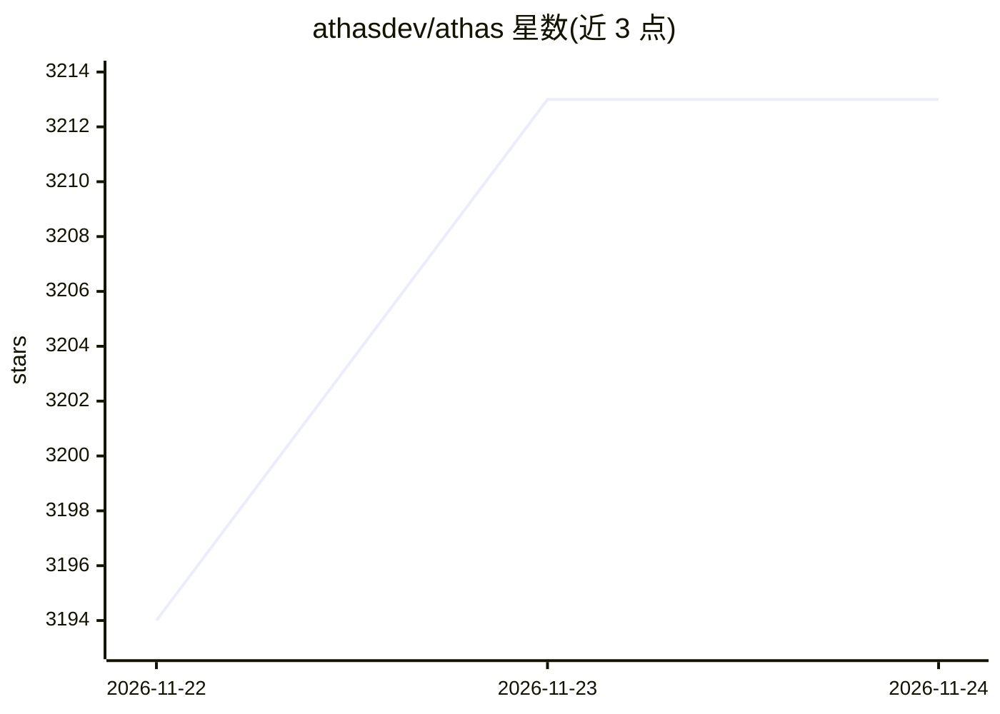

# athasdev/athas

⭐ 3,213 · Rust · AGPL-3.0 · 推送 2026-11-22 · [GitHub](https://github.com/athasdev/athas) · [官网](https://athas.dev) · 组织维护

**为开发者提供带 AI agents 与 vim 键位的跨平台代码编辑器**

用 Rust 编写、基于 GPUI 以 GPU 绘制的跨平台代码编辑器，提供 AI agents、Git 集成、语法高亮、LSP、vim 键位、集成终端、数据库查看器、协作功能，并带有企业策略控制（managed mode 与扩展白名单）。安装方面提供 macOS/Linux/Windows 的 curl/powershell 脚本、Homebrew cask、APT 与 DNF 仓库、预编译包（.deb/.rpm/AppImage/tar.gz）；源码构建需 Rust 工具链及 Linux 下的若干系统库。

## 筛选速览

| 维度 | 判定 | 备注 |
|---|---|---|
| AI 角色 | `ai-enhanced` | 去掉 AI 部分产品仍成立 |
| 许可风险 | `viral` | AGPL-3.0 |
| 部署形态 | `desktop` | 安装包/桌面程序 |
| 模型依赖 | — | README 未给出锁定关系 |
| 硬件要求 | — | 无带数字的原话,不猜 |
| 安装摩擦 | `medium` | 含编译或系统依赖之一 |
| 成熟度 | — | 结构信号不足 |

## 能力要点

- AI agents、Git 集成、LSP、vim 键位、集成终端等编辑器能力
- macOS/Linux/Windows 三平台安装脚本并校验 SHA256
- 提供 Homebrew、APT、DNF 包管理器安装渠道
- Linux 源码构建给出 Debian/Ubuntu 与 Fedora 的依赖库清单

## 适用场景

- 跨平台编辑代码并使用 vim 键位
- 在编辑器中使用 AI agents 辅助开发
- 企业环境通过 managed mode 与扩展白名单管控
- 从源码构建并参与开发

## 场景标签

 · 领域:开发工具/编辑器

## 证据(README 行号)

> L3:  A lightweight, cross-platform code editor, written in Rust and drawn by the GPU with GPUI, with Git support, AI age
> L8: - AI agents

## 星数曲线

2026-11-22 3,194 → 2026-11-24 3,213（+19）

---
*卡片 v1 · prompt 1.4 · 生成 2026-11-23 · 置信度 high · 依据 README sha `3e2b53d8c029` · [字段定义](../../DATASET.md)*
