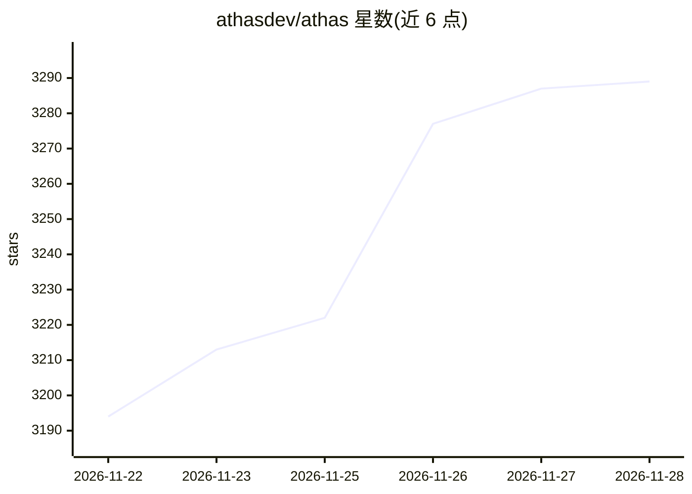

# athasdev/athas

⭐ 3,289 · Rust · AGPL-3.0 · 推送 2026-11-27 · [GitHub](https://github.com/athasdev/athas) · [官网](https://athas.dev) · 组织维护

**Rust+GPU 绘制的跨平台轻量代码编辑器，带 AI agents**

用 Rust 编写、以 GPUI 通过 GPU 绘制的跨平台代码编辑器，功能包括 AI agents、Git 集成、语法高亮、LSP、Vim 键位、集成终端、数据库查看器、协作与企业策略管控。安装方式覆盖 macOS/Linux/Windows 的一键脚本（含 SHA256 校验）、Homebrew、APT/DNF 软件源及 GitHub Releases 预编译包（.deb/.rpm/AppImage/tar.gz）；开发者可从源码构建，Linux 下需先安装链接所需系统库。

## 筛选速览

| 维度 | 判定 | 备注 |
|---|---|---|
| AI 角色 | `ai-enhanced` | 去掉 AI 部分产品仍成立 |
| 许可风险 | `viral` | AGPL-3.0 |
| 部署形态 | `desktop` | 安装包/桌面程序 |
| 模型依赖 | — | README 未给出锁定关系 |
| 硬件要求 | — | 无带数字的原话,不猜 |
| 安装摩擦 | `medium` | 含编译或系统依赖之一 |
| 成熟度 | — | 结构信号不足 |

## 能力要点

- AI agents 功能
- GPUI GPU 渲染的 Rust 编辑器
- LSP 支持与集成终端、数据库查看器
- 多平台多渠道安装：脚本/Homebrew/APT/DNF/预编译包

## 适用场景

- 跨平台日常代码编辑与 Git 版本管理
- 使用 Vim 键位编辑且需要 AI agents 辅助
- 在 Linux/macOS/Windows 间使用统一的编辑器工具链

## 场景标签

 · 领域:开发工具/代码编辑器

## 证据(README 行号)

> L3:  A lightweight, cross-platform code editor, written in Rust and drawn by the GPU with GPUI, with Git support, AI age
> L8: - AI agents

## 星数曲线

2026-11-22 3,194 → 2026-11-28 3,289（+95）

---
*卡片 v1 · prompt 1.4 · 生成 2026-11-27 · 置信度 high · 依据 README sha `cb658071316e` · [字段定义](../../DATASET.md)*
