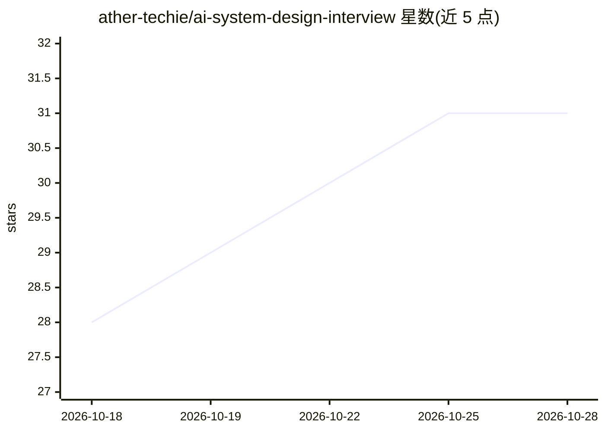

# ather-techie/ai-system-design-interview

⭐ 31 · MIT · 推送 2026-09-01 · [GitHub](https://github.com/ather-techie/ai-system-design-interview) · 个人维护

**面向工程师的 AI/ML 系统设计面试准备指南**

生产级 LLM 系统设计面试的知识仓库：按模块组织 LLM 基础（24 问）、系统设计模式（40 问，含网关、缓存、流式、成本、可观测性）、案例走查（5 个）与学习计划/速查表。每个回答以决策开头，配权衡表或架构图，并以面试官追问收尾。面向准备 Senior/Staff/Principal AI 岗位的工程师，RAG 与 Agents 内容拆分到两个伴生仓库。MIT 许可。

## 筛选速览

| 维度 | 判定 | 备注 |
|---|---|---|
| AI 角色 | `ai-knowledge` | 知识聚合/清单类 |
| 许可风险 | `permissive` | MIT |
| 部署形态 | `None` |  |
| 模型依赖 | — | README 未给出锁定关系 |
| 硬件要求 | — | 无带数字的原话,不猜 |
| 安装摩擦 | `low` | 无编译、无系统依赖或容器化 |
| 成熟度 | — | 结构信号不足 |

## 能力要点

- LLM 基础 24 问 + 系统设计模式 40 问的模块化结构
- 5 个端到端案例走查（LLM 网关、代码助手、内容审核等）
- 按 1 周/2 周/1 月三档提供学习路径
- 伴生仓库覆盖 RAG（200+ 问答）与 Agent 设计模式

## 适用场景

- 准备 FAANG/AI 创业公司的 AI 系统设计面试
- 后端工程师转入 ML 平台/AI 基础设施岗位前补齐 LLM 生产系统知识
- 按时间预算制定面试冲刺学习计划

## 场景标签

`教程课程` · 领域:学习与行业

## 证据(README 行号)

> L11: If you're preparing for an **AI / ML system design interview** — LLM system design, GenAI infrastructure, or an AI 
> L32: ## 🗂️ What's Inside

## 星数曲线

2026-10-18 28 → 2026-10-28 31（+3）

---
*卡片 v1 · prompt 1.4 · 生成 2026-10-26 · 置信度 high · 依据 README sha `9db95939e8a6` · [字段定义](../../DATASET.md)*
