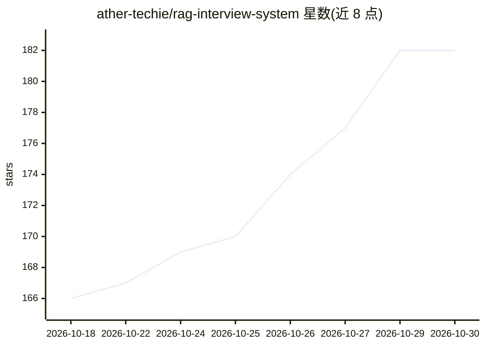

# ather-techie/rag-interview-system

⭐ 182 · JavaScript · MIT · 推送 2026-10-27 · [GitHub](https://github.com/ather-techie/rag-interview-system) · [官网](https://ather-techie.github.io/rag-interview-system/) · 个人维护

**1509 道 RAG 面试问答合集，覆盖 52 种架构与生产故障**

面向 AI/ML 工程师与 LLM 开发者的 RAG 面试准备知识库：收录 1509 道问答（380 基础/554 中级/501 高级），覆盖 52 种 RAG 架构（每类 26 题）、9 类生产故障模式（83 题）及 embeddings、chunking、向量数据库、reranking、评测等核心概念。提供在线问答网站、10/25/50 题自测、1 天/1 周/4 周学习计划，以及 5 个可在 Colab 或本地运行的 Jupyter 实验笔记本。引用论文附 arXiv/DOI 链接。

## 筛选速览

| 维度 | 判定 | 备注 |
|---|---|---|
| AI 角色 | `ai-knowledge` | 知识聚合/清单类 |
| 许可风险 | `permissive` | MIT |
| 部署形态 | `None` |  |
| 模型依赖 | — | README 未给出锁定关系 |
| 硬件要求 | — | 无带数字的原话,不猜 |
| 安装摩擦 | `low` | 无编译、无系统依赖或容器化 |
| 成熟度 | — | 结构信号不足 |

## 能力要点

- 1509 道问答覆盖 52 种 RAG 架构（含 Graph RAG、Agentic RAG、CRAG 等）
- 9 类生产故障模式专题（幻觉、检索失败、语义缓存泄漏等）
- 交互式问答网站与自动评分的多选题自测
- 5 个可运行的 Jupyter 实验笔记本（Naive→Hybrid→Reranker→RAGAS→Agentic）

## 适用场景

- 准备 RAG / LLM / GenAI 工程师岗位的技术面试
- 系统设计轮次前学习 RAG 架构分类与生产模式
- 招聘方挑选 GenAI 岗位面试题库

## 场景标签

`教程课程` `精选清单` · 领域:学习与行业

## 证据(README 行号)

> L11:  RAG (Retrieval-Augmented Generation) Interview Questions and Answers — 1509 Q&A covering 52 architectures and prod
> L13: **1509 RAG (Retrieval-Augmented Generation) interview questions and answers** for AI engineers, ML engineers, and G
> L179:  **Grand Total: 1509 questions**

## 星数曲线

2026-10-18 166 → 2026-10-30 182（+16）

---
*卡片 v1 · prompt 1.4 · 生成 2026-10-22 · 置信度 high · 依据 README sha `acdbb08a2b48` · [字段定义](../../DATASET.md)*
