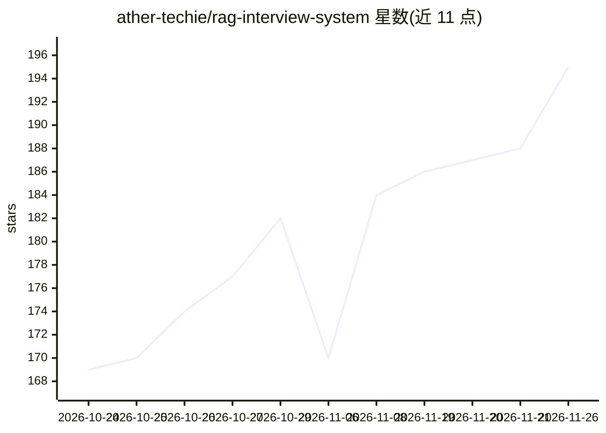

# ather-techie/rag-interview-system

⭐ 195 · JavaScript · MIT · 推送 2026-11-02 · [GitHub](https://github.com/ather-techie/rag-interview-system) · [官网](https://ather-techie.github.io/rag-interview-system/) · 个人维护

**面向 AI/LLM 工程师的 RAG 面试题库（1619 题、52 种架构）**

RAG 面试准备知识库：收录 1619 道问答，覆盖 52 种 RAG 架构、核心概念（嵌入、分块、向量库、评估等）、生产故障模式与 Microsoft/Azure 栈专题，按难度分级并含 218 道场景题与 228 道选择题。配套浏览器端练习测验与自测（计时、就绪度、历史记录）、速查表、学习路径，以及 5 个可在 Colab 运行的 Jupyter 实验（Naive RAG 到 Agentic RAG、RAGAS 评估）。面向准备 RAG/GenAI 面试的工程师、转型 LLM 开发的软件工程师与构建题库的面试官。

## 筛选速览

| 维度 | 判定 | 备注 |
|---|---|---|
| AI 角色 | `ai-knowledge` | 知识聚合/清单类 |
| 许可风险 | `permissive` | MIT |
| 部署形态 | `None` |  |
| 模型依赖 | — | README 未给出锁定关系 |
| 硬件要求 | — | 无带数字的原话,不猜 |
| 安装摩擦 | `low` | 无编译、无系统依赖或容器化 |
| 成熟度 | — | 结构信号不足 |

## 能力要点

- 1619 道问答覆盖 52 种 RAG 架构与生产故障模式
- 浏览器端 Practice Quiz 与 Self-Assessment（计时、就绪度、答题历史）
- 5 个 Jupyter 实验 notebook，提供 Open In Colab 徽章免本地安装
- 引用论文附 arXiv/DOI 链接，另有速查表与学习路径

## 适用场景

- 准备 RAG/LLM/GenAI 岗位的面试与系统设计轮次
- 用闪卡与选择题按难度和章节自测、追踪进度
- 在浏览器里跑通 Naive 到 Agentic RAG 实验管道
- 面试官为 GenAI 岗位构建题目集

## 场景标签

`教程课程` · 领域:学习与行业

## 证据(README 行号)

> L13: **1619 RAG (Retrieval-Augmented Generation) interview questions and answers** for AI engineers, ML engineers, and G
> L255: |06|Labs|5 Jupyter notebooks: Naive RAG → Hybrid RAG → Reranker → RAGAS Evaluation → Agentic RAG. Each has an Open

## 星数曲线

2026-10-24 169 → 2026-11-26 195（+26）

---
*卡片 v1 · prompt 1.4 · 生成 2026-11-26 · 置信度 high · 依据 README sha `bbedcdf4b4e8` · [字段定义](../../DATASET.md)*
